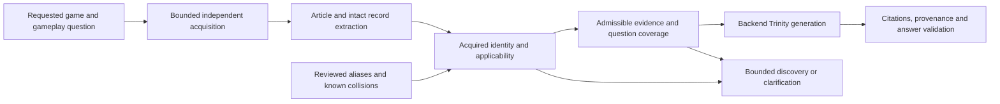

# Gaming identity beyond the registry

## Baseline and merged dependency

This capability starts from reviewed PR #1542 commit
`e24d5614748f39e25e27a0c062dfba2ea0adbb77`. PR #1542 was open and
draft when this branch was created, then merged into `main` as
`f34da2cc1565bd2105af4254cf41b0a9634afe9e`. The merge commit has the
reviewed #1542 tree and preserves its ancestry. PR #1543 remains draft and
targets `main`; its capability increment is the diff after #1542's reviewed
head. The original validation receipts record the earlier, unmerged baseline;
the [post-merge integration record](audits/2026-10-14/gaming-universal-identity/post-merge-integration.md)
records verification against the merged baseline.

## Architecture assessment before implementation

The request already accepts uncatalogued game names. Literal source/request
equality, transport bounds, document extraction, structural record validation,
question coverage, hybrid revision/idempotency, and Trinity orchestration are
largely generic. Registry data supplies aliases, known related titles, reviewed
editions and disambiguation; it is not intended to grant source authority.

The pre-change generic-topic path in `gamingClearSource.ts` requires both a
closed topic classification and a registry-recognized affirmative body alias.
Thus an unfamiliar game's independently acquired declaration cannot ground a
generic topic heading on that path. Heuristic title detection can also mistake
novel mechanics for game names. `gamingGameDetection.ts` canonicalization scans
aliases inside longer names, risking loss of an unfamiliar subtitle. The build
prompt in `gamingPromptCore.ts` assumes RPG stats, weapons and talismans.

The implementation keeps the existing trust sequence and makes acquired full
game declarations independent from the topic vocabulary. Recognition of a
title in a request, URL, search snippet or page metadata cannot by itself
verify acquired identity. Explicit conflicting subjects, incomplete inspection,
and ambiguous family/edition boundaries retain conservative outcomes. Generic
topic recognition never supplies game identity or invents mechanics.

## Identity contract

`gamingAcquiredIdentity.ts` distinguishes `IDENTITY_VERIFIED`,
`IDENTITY_UNVERIFIED`, `IDENTITY_CONFLICT`, and `INSUFFICIENT_EVIDENCE` before the
existing public verified/unknown/conflict assessment. Full acquired subjects
are compared deterministically. Registry aliases still disambiguate known
games; unfamiliar subtitles are preserved. Formatting normalization handles
case, punctuation and apostrophes, plus standalone title-ending Roman numerals
II through X, including before an explicit subtitle separator. The subtitle
remains part of identity; leading title words such as V in V Rising are preserved.
It does not perform fuzzy matching or infer translations.

An article may declare a bounded source-local alias, but a separate canonical
body assertion must corroborate it. Shared alias ownership remains unresolved,
and acquired aliases cannot override reviewed registry ownership. Ordinary
single-word names, acronyms and recognized topic names require explicit
acquired game context. A title, URL, request label, comparison or quotation
cannot supply that context. Positive anchors are bounded to the primary 32K
characters; contradiction inspection retains the complete bounded document.

Metadata detection labels an unfamiliar guide-title candidate as an article
subject rather than an established game identity. An acquired definition can
bind the exact topic to its game, including locations, quests, characters and
mechanics; a heading or repeated topic alone cannot supply that ownership.
Missing corroboration remains `GAME_IDENTITY_UNVERIFIED`, while independently
contradictory primary identities still reject. Explicit declarations retain
complete sentence-like titles in statements such as
"This guide covers ..."; gameplay-predicate trimming applies only to
prepositional scope. Source-local alias declarations
allow full names of up to 120 characters, including subtitle punctuation, and
still require separate canonical body proof. They cannot establish equivalence
across sequels, DLC, remakes or editions. Reviewed registry edition relationships
recognize colon and dash separators without discarding the edition scope or
proving compatibility between editions. Unreviewed alternate edition names
remain distinct and cannot inherit base-game mechanics.

Bare unfamiliar headings can describe any gameplay system when independently
acquired game scope is established. An unfamiliar guide-framed mechanic heading
can be owned by a separately acquired explicit named-game scope without a closed
topic vocabulary. Registered foreign headings and independently declared foreign
game subjects still conflict. Existing topic lists
remain useful conservative ambiguity signals, rather than a mandatory topic
allowlist. Unsupported structural column schemas and ambiguous formats remain
unverified. Trinity receives selected source mechanics and no longer requires
RPG-specific stats, weapons or talismans for every build.

Reviewed official currentness adapters can independently bind acquired release
records to a matching game title. Incomplete index/article evidence never becomes
a latest-patch claim. Missing platform DOM, unsupported qualifiers and version
conflicts still withhold ownership. This preserves existing currentness
capability without adding a publisher allowlist for unfamiliar games.

## Synthetic cross-game workflow matrix

| Game | Exercised question area | Competing identity |
| --- | --- | --- |
| Elden Ring | Unsheathe timing; existing Samurai regressions | Nightreign |
| Fallout 76 | Ammunition conservation; existing Heavy Gunner regressions | Fallout 4 |
| Baldur's Gate 3 | Tactical spacing | Divinity: Original Sin 2 |
| Stardew Valley | Irrigation layout | Harvest Moon |
| Monster Hunter Wilds | Wound observation | Monster Hunter World |
| Destiny 2 | Orb routing | Warframe |
| Civilization VI | District adjacency layout | Civilization V |
| Hollow Knight | Soul recovery | Hollow Knight Silksong |
| Copperwind Loom (synthetic, unregistered) | Resonance braiding and chime lattice layout | Glasswake Almanac (synthetic) |

All nine exercise a positive answer, missing/comparison-only identity,
wrong-game recovery and stopping, irrelevant furniture, and insufficient
question coverage. The original 63-case integration suite also exercises revision and
idempotency enforcement, actor isolation, acquisition deadlines, no-consent
write sentinels, semantic-audit refusal and mixed Elden Ring/Nightreign selection.
The intake, reasoning, final and answer-audit stages use the existing Trinity
pipeline. HTTP/DNS and provider responses are synthetic; gameplay sentences in
these original fixtures are not verified advice about the real games.

The generic prose capability does not prove every game's rules, publisher
format, localized alias or newly released patch. Currentness authority remains
separate. Guide selection excludes unrelated sections; build chunks may retain
nearby article prose within existing chunk bounds, so answer grounding and
citation validation remain necessary after selection.

## Validation and release boundary

Fixtures use synthetic acquired HTML and real production validators. Hybrid
tests run the backend workflow and Trinity orchestration with synthetic
external transport and provider responses. These tests establish the exercised
capability and negative controls, not compatibility with every game or publisher.
Live source acquisition and live model acceptance require separate authorization.

Independent review extended the actual workflow to 77 cases with four additional
invented games absent from production code: Velvet Meridian, Velvet Meridian Echoes,
Drift, and Aurora Atlas IV: The Quiet Tide. Their unfamiliar mechanics reach
grounded Trinity answers; overlapping foreign titles, missing coverage and mixed
acquired identities remain bounded negative paths. Additional acquired-document
tests cover Journey, Silver Harbor, Slate Meridian, localized titles, novel
guide-framed topics, incomplete statistics and durable consent.

Internal CLEAR policy v6 invalidates prior v1/v2/v3/v4/v5 assessments while preserving
the public `gaming-clear/v1` schema. Context fingerprints include the policy
revision, and approved hybrid ingestion revisions bind that revision. Existing
extraction caches may reuse bounded acquired bytes; approval decisions require
current assessment. Review tightened reference-only prose rejection; v3 snapshots
must therefore be reassessed rather than carrying old identity authority forward.
Invalidated explicit assessments also mark their request-local applicability
projection unverified. A complete historical snapshot cannot restore acceptance
through legacy fallback; stored text and existing restrictions remain readable,
and no database record is changed by this validation.
Exact-artifact current approvals govern durable identity instead of a second
metadata-only guess. Unapproved ingestion retains its mismatch guard.
This change introduces no shared identity cache, catalog
service, model parser, or storage permission. Old queued approvals fail before
acquisition or persistence and must be reassessed through the existing workflow.
Source-local aliases can establish prose ownership, but an alias-valued structural
Game field is conservatively excluded. It is not promoted into a canonical
record or shared across sources; supporting it throughout storage and selection
would require a separately designed provenance contract.

Complete, bounded sentences introduced by “For comparison, in ...” or
“By comparison, in ...”, with either a comma or colon after “comparison”, use
the existing local-reference projection. Their game
mentions cannot establish article identity, edition applicability, or gameplay
claim support. Independent source-global declarations and a second affirmative
game clause remain inspectable; incomplete or over-budget references are never
discarded to obtain acceptance. The acquired document remains unchanged for
hashes and provenance. Original games, remakes, remasters and sequels still need
matching complete acquired identity; no publisher or game-specific exception is
introduced.

An ordinary location inside a comparison does not introduce a second game scope.
Closed lowercase phrases such as “in the game shop”, “in the game world” and
“in the game menu” remain locations. Quoting a whole reference clause differs
from quoting only an independently declared game name; named, unfamiliar and
ambiguous game declarations remain inspectable.
Independent named-game clauses and explicit `Game:` or `Edition:` declarations
remain inspectable. An unfinished or over-budget comparison cannot hide an
edition assertion or preserve earlier verified compatibility.
Unquoted source-global `Platform:`/`Platforms:` and `Region:`/`Regions:` labels
also remain inspectable inside comparison framing. A completely quoted example
stays local; quoting only the value of an unquoted label leaves its restriction
binding. Parser-owned gameplay record fields retain their existing local scope.
Applicability reads the original acquired page before reference projection;
comparison gameplay and arbitrary field-value tails cannot become selected claim
support. Fresh and retained-record callers pass the original source to this
existing applicability parser.

Bare location clauses must own their leading nominal subject before metadata
title inference can assert another game. A price or purpose after a nested
“for/in/on” phrase cannot rename the acquired location. Explicit named-game
declarations, known game aliases, guide-framed unfamiliar names and full
sequel/remake qualifiers retain their existing contradiction checks.

A closed page description that merely lists or indexes topic records cannot
supply gameplay coverage. Fresh plain-text chunks are checked with their exact
acquired headings and nominal game context before display metadata is redacted.
The original document and structural provenance remain intact; complete records
and independent declarative gameplay facts keep their existing selection rules.
The same overview boundary applies to stored request coverage and the full CLEAR
evidence assessment. Page-description wording does not become claim support by
being persisted, and factual values or qualifications in acquired headings remain
evidence rather than metadata boilerplate.
An exact nominal topic heading such as `Elden Ring Uchigatana location guide`
cannot turn a description of that topic into acquisition instructions. The same
boundary applies before fresh generation and after stored-source retrieval.

Periods internal to acquired titles, such as decimal release names, are not
sentence boundaries. The existing 160-character subject window and 512-character
comparison window remain bounded, with a non-authoritative lookahead for edge
inspection. Plain-text derivatives can establish ownership through an exact,
independently acquired `in the game FULL NAME` scope. A URL, separate Archive item
title, bare mention or comparison cannot replace that evidence; contradictions,
edition applicability and incomplete-inspection checks still bind the document.

Deployment identity and live acceptance remain separate gates:
`DEPLOYED_SHA_UNVERIFIED` and `LIVE_ACCEPTANCE_NOT_RUN`.

## Adversarial verification and performance methodology

The focused offline checks include 45 adversarial cases in
`tests/gaming-universal-adversarial.test.ts`, 18 official currentness ownership
cases in `tests/gaming-universal-currentness-identity.test.ts`, and the paired
benchmark in `tests/gaming-universal-performance.test.ts`. The acquisition
fixtures replace HTTP and DNS transport while retaining the protected resolver,
its document attestation, HTML extraction and production identity assessment.
They cover conflicting title/body ownership, source furniture, shared aliases,
unknown spin-offs, edition restrictions, ordinary-word names, frontend-only
claims, instructions, reference-only mentions, and incomplete records. Matched
titles cannot turn exclusions, quotations or a reader's requested game into
affirmative body evidence. The official cases use synthetic HTML with the
existing reviewed adapters; they establish no claim about a live publisher page.

The benchmark fixture ran unchanged against `e24d5614748f39e25e27a0c062dfba2ea0adbb77`
and the implementation under review. Each of 14 cases uses three warmups and
five measured repetitions under Node 24.18.1/npm 11.16.0 on Windows, with coverage
disabled. Cases include 32K, 128K and 512K sources, a late foreign declaration,
and the existing one-million-character and 1,024-assertion limits. For the matched
512K known-game positive case, median assessment time was 21.619 ms before and
16.279 ms after; the matched foreign-game rejection was 7.349 ms and 7.610 ms.
The 1,025-assertion overflow remained unverified, with medians of 134.781 ms and
141.736 ms. Novel-game positives were unverified on the baseline and verified
afterward; their timings do not compare equivalent acceptance behavior.

These are local warmed identity-assessment measurements, with scheduling and
measurement variance. They exclude acquisition, database, provider and production
latency, and introduce no production budget changes. Exact non-Latin names are
tested with explicit unquoted acquired declarations; these cases do not establish
support for every quoted-title layout, transliteration, homograph, game or
publisher. Ambiguous or unsupported acquired formats remain unverified.
