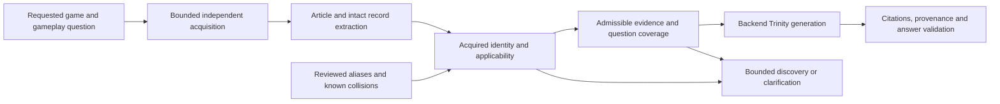

# Gaming identity beyond the registry

## Baseline and dependency

This capability starts from reviewed PR #1542 commit
`e24d5614748f39e25e27a0c062dfba2ea0adbb77`. PR #1542 was still open and
draft when the task branch was created; its branch and regression fixtures are
preserved. The new draft PR targets `main` so the canonical CI workflows run,
and depends on #1542. Its incremental implementation can be reviewed against
that commit until the parent merges.

## Architecture assessment before implementation

The request already accepts uncatalogued game names. Literal source/request
equality, transport bounds, document extraction, structural record validation,
question coverage, hybrid revision/idempotency, and Trinity orchestration are
largely generic. Registry data supplies aliases, known related titles, reviewed
editions and disambiguation; it is not intended to grant source authority.

The pre-change generic-topic path in `gamingClearSource.ts` requires both a
closed topic classification and a registry-recognized affirmative body alias.
Thus an unfamiliar game's independently acquired declaration cannot ground a
generic topic heading on that path. Heuristic title detection can also mistake
novel mechanics for game names. `gamingGameDetection.ts` canonicalization scans
aliases inside longer names, risking loss of an unfamiliar subtitle. The build
prompt in `gamingPromptCore.ts` assumes RPG stats, weapons and talismans.

The implementation keeps the existing trust sequence and makes acquired full
game declarations independent from the topic vocabulary. Recognition of a
title in a request, URL, search snippet or page metadata cannot by itself
verify acquired identity. Explicit conflicting subjects, incomplete inspection,
and ambiguous family/edition boundaries retain conservative outcomes. Generic
topic recognition never supplies game identity or invents mechanics.

## Identity contract

`gamingAcquiredIdentity.ts` distinguishes `IDENTITY_VERIFIED`,
`IDENTITY_UNVERIFIED`, `IDENTITY_CONFLICT`, and `INSUFFICIENT_EVIDENCE` before the
existing public verified/unknown/conflict assessment. Full acquired subjects
are compared deterministically. Registry aliases still disambiguate known
games; unfamiliar subtitles are preserved. Formatting normalization handles
case, punctuation and apostrophes, plus standalone trailing Roman numerals
II through X. It does not perform fuzzy matching or infer translations.

An article may declare a bounded source-local alias, but a separate canonical
body assertion must corroborate it. Shared alias ownership remains unresolved,
and acquired aliases cannot override reviewed registry ownership. Ordinary
single-word names, acronyms and recognized topic names require explicit
acquired game context. A title, URL, request label, comparison or quotation
cannot supply that context. Positive anchors are bounded to the primary 32K
characters; contradiction inspection retains the complete bounded document.

Bare unfamiliar headings can describe any gameplay system when independently
acquired game scope is established. A guide-framed heading that could name
another game still requires source-owned topic context. Existing topic lists
remain useful conservative ambiguity signals, rather than a mandatory topic
allowlist. Unsupported structural column schemas and ambiguous formats remain
unverified. Trinity receives selected source mechanics and no longer requires
RPG-specific stats, weapons or talismans for every build.

Reviewed official currentness adapters can independently bind acquired release
records to a matching game title. Incomplete index/article evidence never becomes
a latest-patch claim. Missing platform DOM, unsupported qualifiers and version
conflicts still withhold ownership. This preserves existing currentness
capability without adding a publisher allowlist for unfamiliar games.

## Synthetic cross-game workflow matrix

| Game | Exercised question area | Competing identity |
| --- | --- | --- |
| Elden Ring | Unsheathe timing; existing Samurai regressions | Nightreign |
| Fallout 76 | Ammunition conservation; existing Heavy Gunner regressions | Fallout 4 |
| Baldur's Gate 3 | Tactical spacing | Divinity: Original Sin 2 |
| Stardew Valley | Irrigation layout | Harvest Moon |
| Monster Hunter Wilds | Wound observation | Monster Hunter World |
| Destiny 2 | Orb routing | Warframe |
| Civilization VI | District adjacency layout | Civilization V |
| Hollow Knight | Soul recovery | Hollow Knight Silksong |
| Copperwind Loom (synthetic, unregistered) | Resonance braiding and chime lattice layout | Glasswake Almanac (synthetic) |

All nine exercise a positive answer, missing/comparison-only identity,
wrong-game recovery and stopping, irrelevant furniture, and insufficient
question coverage. The 63-case integration suite also exercises revision and
idempotency enforcement, actor isolation, acquisition deadlines, no-consent
write sentinels, semantic-audit refusal and mixed Elden Ring/Nightreign selection.
The intake, reasoning, final and answer-audit stages use the existing Trinity
pipeline. HTTP/DNS and provider responses are synthetic; gameplay sentences in
these original fixtures are not verified advice about the real games.

The generic prose capability does not prove every game's rules, publisher
format, localized alias or newly released patch. Currentness authority remains
separate. Guide selection excludes unrelated sections; build chunks may retain
nearby article prose within existing chunk bounds, so answer grounding and
citation validation remain necessary after selection.

## Validation and release boundary

Fixtures use synthetic acquired HTML and real production validators. Hybrid
tests run the backend workflow and Trinity orchestration with synthetic
external transport and provider responses. These tests establish the exercised
capability and negative controls, not compatibility with every game or publisher.
Live source acquisition and live model acceptance require separate authorization.

Internal CLEAR policy v3 invalidates prior v1/v2 assessments while preserving
the public `gaming-clear/v1` schema. Context fingerprints include the policy
revision, and approved hybrid ingestion revisions bind that revision. Existing
extraction caches may reuse bounded acquired bytes; approval decisions require
current assessment. This change introduces no shared identity cache, catalog
service, model parser, or storage permission. Old queued approvals fail before
acquisition or persistence and must be reassessed through the existing workflow.

Deployment identity and live acceptance remain separate gates:
`DEPLOYED_SHA_UNVERIFIED` and `LIVE_ACCEPTANCE_NOT_RUN`.

## Adversarial verification and performance methodology

The focused offline checks include 45 adversarial cases in
`tests/gaming-universal-adversarial.test.ts`, 18 official currentness ownership
cases in `tests/gaming-universal-currentness-identity.test.ts`, and the paired
benchmark in `tests/gaming-universal-performance.test.ts`. The acquisition
fixtures replace HTTP and DNS transport while retaining the protected resolver,
its document attestation, HTML extraction and production identity assessment.
They cover conflicting title/body ownership, source furniture, shared aliases,
unknown spin-offs, edition restrictions, ordinary-word names, frontend-only
claims, instructions, reference-only mentions, and incomplete records. Matched
titles cannot turn exclusions, quotations or a reader's requested game into
affirmative body evidence. The official cases use synthetic HTML with the
existing reviewed adapters; they establish no claim about a live publisher page.

The benchmark fixture ran unchanged against `e24d5614748f39e25e27a0c062dfba2ea0adbb77`
and the implementation under review. Each of 14 cases uses three warmups and
five measured repetitions under Node 24.18.1/npm 11.16.0 on Windows, with coverage
disabled. Cases include 32K, 128K and 512K sources, a late foreign declaration,
and the existing one-million-character and 1,024-assertion limits. For the matched
512K known-game positive case, median assessment time was 21.880 ms before and
16.003 ms after; the matched foreign-game rejection was 7.467 ms and 7.495 ms.
The 1,025-assertion overflow remained unverified, with medians of 138.231 ms and
147.037 ms. Novel-game positives were unverified on the baseline and verified
afterward; their timings do not compare equivalent acceptance behavior.

These are local warmed identity-assessment measurements, with scheduling and
measurement variance. They exclude acquisition, database, provider and production
latency, and introduce no production budget changes. Exact non-Latin names are
tested with explicit unquoted acquired declarations; these cases do not establish
support for every quoted-title layout, transliteration, homograph, game or
publisher. Ambiguous or unsupported acquired formats remain unverified.
