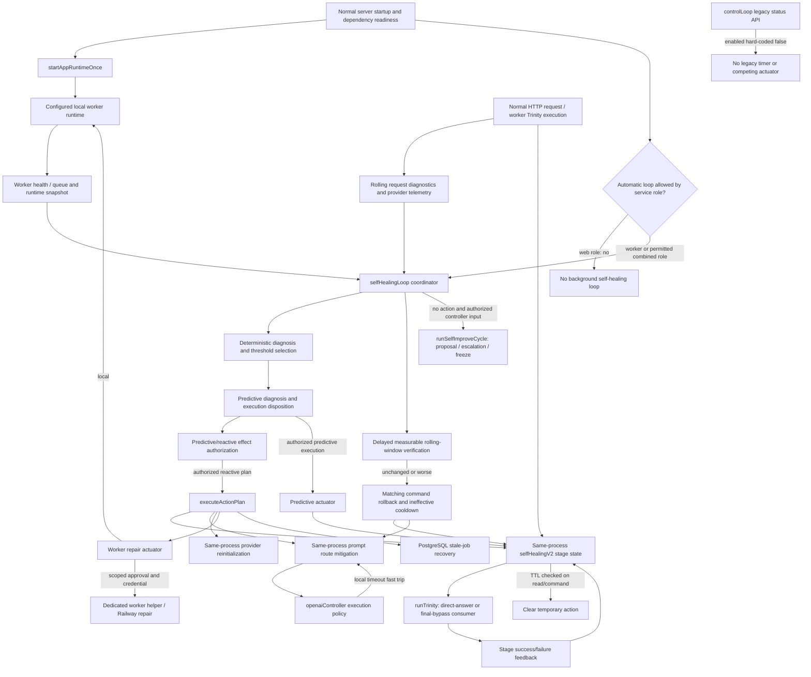

# Self-healing ownership and data flow

Architecture inspection date: 2026-10-12. Repository: `pbjustin/Arcanos`.
PR: [#1539](https://github.com/pbjustin/Arcanos/pull/1539).
Inspected head: `ec3ed16cb94c9166902bc810d0d73f89d322cf67`.
Base: `3fd305b37ba410cf21684a8fed7619a1ba180b48`.
Branch: `codex/targeted-security-healing-20261012`; draft: false.

This map was produced by source inspection before acceptance test execution.
The source references below describe the inspected head; later acceptance
changes must be assessed separately. Railway identities and live results belong
in `self-healing-preview-evidence.md`. Source inspection does not establish a
deployment's identity, isolation, or successful recovery.

## Ownership map

Authorized profile preparation adds a credential-free planning and attestation
boundary, described in the [provisioning proposal](self-healing-preview-provisioning-plan.md).
It declares fresh preview-exclusive web/worker/storage identities and a separate
normal-runtime namespace. It does not change any runtime owner, start a
controller, deploy a service or deliver mitigation across processes. The
runtime map below remains unchanged; live controller/consumer evidence is
still unavailable.

Recovery follow-up at `2fd4cf81833ba3be4592654bc7789dd3309374d7`:
the original pre-test map remains historical evidence; no source/runtime
architecture was changed during recovery investigation. The managed native
preview is intentionally a different runtime from this map. Its ownership
validator admits two fixed project-level service IDs, no volumes/shared vars,
role-only per-service variables and the sealed launcher. Production identity
inspection confirmed those fixed IDs also have production instances.
Distinct environment instances do not satisfy this mission's stronger
requirement for preview-exclusive service IDs. The workflow was not activated.

The normal-runtime diagnostics lane documented in `docs/RAILWAY_DEPLOYMENT.md`
uses `worker-diagnostics-pr-<PR>-e2e`, not the reserved native namespace.
It is a documented manual lane with a trusted cleanup backstop, not an existing
self-healing provisioning workflow. Its cleanup allowlist also pins the
production-shared web/worker/PostgreSQL/Redis IDs. The separate Live PR
Acceptance workflow supports only `gaming-guide`. Neither is a compliant
replacement target for this mission without an owner-installed managed profile.

Normal web suppresses the canonical scheduler intentionally. The dedicated
normal worker starts `dist/workers/jobRunner.js` and does not start that
scheduler. A same-process manual controller/Trinity path can be deliberately
authorized without distributed state; a worker-controller selection cannot
prove another web process consumed a command. A future genuine preview run
must identify its permitted controller/consumer pair before baseline/faults.
No production owner or role policy was changed to create apparent recovery.



Every same-process edge is important: this implementation does not publish a
Trinity mitigation command to Redis, PostgreSQL, or another service. A
controller log on a worker cannot prove a separate web instance consumed that
command. Worker jobs that execute Trinity in the controller's own process can
consume its state. An explicitly authorized manual command running in the web
process can also mutate the state that its subsequent web requests consume.

| Responsibility | Owner and source references | Runtime boundary |
| --- | --- | --- |
| Normal startup | `src/server.ts:startServer` lines 309-338; `src/app.ts:startAppRuntimeOnce` lines 129-135 | Listener/preflight/dependency readiness precede one-time runtime activation. |
| Scheduled detection | `selfHealingLoop.ts:observeSelfHealingRuntime` lines 1532-1552 and `diagnoseSelfHealingRuntime` lines 2300-2456 | Worker health, local runtime status, local request window, telemetry, local provider health and Trinity snapshot. |
| Request-stage detection | `selfHealingV2.ts:recordTrinityStageFailure` lines 301-377; `trinity.ts` lines 1715-1737, 1784-1806, 2013-2033 | Simple-tier abort-class failures; automatic mutation suppressed in web role. The request's immediate timeout fallback is distinct from persistent mitigation. |
| Mitigation selection | `selfHealingLoop.ts:buildDiagnosisSummary` line 1985 and `buildLatencyMitigationActionPlan` lines 1824-1873; `predictiveHealingService.ts:executeDecision` line 2611 | Worker recovery, provider reinitialization, Trinity degradation, prompt latency/degradation; predictive supported-action selection. |
| Effect authorization | `src/shared/selfHealPredictiveApproval.ts` lines 43-119; `selfHealingLoop.ts:aiDiagnoseAndDecide` line 1168 and dispatch lines 4001-4065 | A recommendation, dry run, uncertain failed execution, or inconsistent predictive result cannot silently authorize reactive effects. |
| Command application | `selfHealingV2.ts:activateTrinitySelfHealingMitigation` lines 209-263; `selfHealingLoop.ts:executeActionPlan` lines 3053-3754 | In-memory commands; enabled/autonomy/freeze, action support, budget, duplicate, failed-action and cooldown checks. |
| Trinity consumer | `src/core/logic/trinity.ts` lines 1015-1026, 1655-1671, 1975-1985 and 2289-2302 | `getTrinitySelfHealingMitigation` selects same-process state; consumer changes the executed path and records outcomes. |
| Prompt consumer | `src/transport/http/controllers/openaiController.ts` lines 122-159 and 381-399; `promptRouteMitigation.ts:getPromptRouteExecutionPolicy` lines 312-353 | Reads same-process policy; reduced retries/timeouts/tokens/fallback or explicit degraded response. Route-local timeout detection independently activates reduced latency. |
| Worker repair | `workerRepairActuator.ts:buildWorkerRepairActuatorStatus` lines 505-591 and `executeWorkerRepairActuator` lines 594-641 | Local worker restart; remote helper or Railway actuator requires separate explicit approval and correct configured target. Web-role repair is disabled. |
| Queue execution/recovery | `src/workers/jobRunner.ts`; `src/services/workerAutonomyService.ts`; `src/core/db/repositories/jobRepository.ts` | PostgreSQL transactional claims, leases/generation fencing, retry and terminal persistence. Separate from process-local mitigation. |
| Evidence history | `selfHealTelemetry.ts:recordSelfHealEvent` lines 776-824; persistence target lines 181-215 | Events can persist to Redis, Railway volume or a file; active commands and coordinator pending verification are not restored from event history. |
| Legacy API | `controlLoop.ts:getLoopConfig` lines 161-179; `startSelfHealingControlLoop` lines 1040-1073 | Permanently disabled legacy loop; retained inspection API is intentionally superseded. Trinity no longer consumes its separate mitigation store. |

Paths abbreviated in this table are under `src/services/selfImprove/`, except
`promptRouteMitigation.ts`, which is under `src/services/openai/`.

## Authorization and service roles

`unifiedConfig.ts:resolveWorkerRuntimeMode` lines 285-315 forces workers off for
`ARCANOS_PROCESS_KIND=web`, on for `worker`, and uses `RUN_WORKERS` for the
`unknown`/combined role. Its stable resolution is cached outside tests.
`isWorkerRuntimeSuppressedForServiceRole` lines 332-335 identifies the web role.

`startSelfHealingLoop` lines 4154-4170 and automatic ticks at lines 3832-3847
respect that role boundary. `recordTrinityStageFailure` lines 307-312 applies the
same suppression. This is explicit ownership policy, not evidence that a
disabled loop healed traffic. Manual ticks are preserved; their HTTP entry
points require authentication, operator identity and action scopes.

`src/app.ts` lines 258-264 places the self-healing authentication boundary before
body parsing. `selfHealingControlHttpBoundary.ts` lines 121-126 combines security
headers, client rate limiting, authentication and operator admission.
`src/routes/self-heal.ts` defines `arcanos:read`, `self-heal:decide`,
`self-heal:execute` and `self-heal:probe`; executing decisions requires decide
and execute scopes. `src/routes/self-improve.ts` separately gates manual loop
execution and control mutations. A caller's body or confirmation flag does not
establish those privileges.

Trinity V2 is enabled only with `SELF_IMPROVE_ENABLED`, actuator mode `daemon`,
autonomy level at least 3, and no configured freeze (`selfHealingV2.ts` lines
80-95). Its public internal functions are not independent HTTP authentication
boundaries. Remote repair uses a scoped action approval with approver, reason,
matching action and future expiry (`operatorApproval.ts` lines 58-96). HTTPS
remote-helper URLs, bounded JSON responses, rejection of redirects and a helper
credential are additional transport controls, not preview-isolation proof.

`governance/loop_contract.yaml` distinguishes soft configuration from hard code,
permissions, security and deployment changes. `governance/README.md` requires
staged validation and evidence. `controller.ts:runSelfImproveCycle` loads the
machine contract, effective autonomy and kill switch; high-severity drift
freezes and enters rollback posture. Patch/PR proposal is a separate effect path
and can invoke models, storage and GitHub. It must be mocked or disabled for
contained acceptance scenarios. Its deployment/production permissions are not
implied by this mission.

## Detection, cooldowns and temporary state

The canonical loop samples a five-minute window and normally ticks every 30
seconds. `selfHealingLoop.ts` lines 1346-1432 resolve bounded environment
overrides. Defaults include 12 minimum requests, 18% error rate, 15% timeout
rate, three timeout/provider failures, p95 4.5 seconds and three action attempts
per diagnosis per ten-minute incident window. Detection also contains explicitly
smaller prompt-route/pipeline burst rules; the general minimum request threshold
does not override those rules (`diagnoseSelfHealingRuntime` lines 2323-2389).
Healthy backlog and client validation noise have separate treatment. Selection
prioritizes worker stalls, prompt-route stabilization, provider failures,
pipeline timeouts, timeout storms, latency and server errors.

Canonical coordinator state lives at
`globalThis.__ARCANOS_SELF_HEAL_RUNTIME__` (`selfHealingLoop.ts` lines 1493-1513).
It contains one in-flight lock, one pending verification, action/controller/
ineffective cooldown maps and diagnosis-attempt maps. Duplicate calls skip an
in-flight tick (lines 3849-3875). An existing pending verification prevents a
second reactive action (lines 3059-3073). The default action cooldown is two
minutes; controller cooldown five minutes; ineffective cooldown ten minutes.
Successful rollback owns its tick before prediction (lines 3920-3953).
Predictive execution dispositions prevent a second reactive action in the same
cycle, but these are process-level guards, not distributed locks.

Trinity state is one module-local `stageState` record with `intake`, `reasoning`
and `final` entries (`selfHealingV2.ts` lines 24-76). Automatic stage activation
requires three observations within five minutes. Each stage has a maximum of
three applied attempts, a two-minute rollback cooldown, ten-minute action TTL,
three successful verification observations and two failures for rollback.
Intake/reasoning support `enable_degraded_mode`; final first supports
`bypass_final_stage`, then degraded mode (lines 45-57).

Expiration is lazy: reads and commands call `expireActionIfNeeded` (lines
103-119, 448-451). TTL clears the command and verification counters; it does not
reset stage attempt count, observation history, cooldown or failed-action
history. Those remaining fields are process-lifetime state. Stage snapshots
therefore need inspection after expiration, not an assumption that every budget
returned to a fresh baseline.

`getTrinitySelfHealingMitigation` lines 433-480 returns no command for non-simple
tiers. It combines all stage flags with intake, then reasoning, then final
priority for the selected action/stage. Concurrent active stages can exist;
consumer feedback is attributed to the selected stage, so concurrency evidence
must inspect all stage entries and the execution actually chosen.

Prompt mitigation uses a different process-global state, with route timeout
window, threshold and cooldown (`promptRouteMitigation.ts` lines 42-53,
254-309). At the inspected head it has no TTL field or automatic expiration.
Successful canonical verification retains it; explicit rollback or process
restart clears it. The web-role restriction of the scheduled coordinator does
not disable this separate local prompt timeout fast trip. That distinction must
remain explicit in service-role tests.

## Recovery, rollback and restart

Canonical verification starts with a baseline snapshot and normally waits 90
seconds (`beginVerification`, lines 2696-2720). It compares error/timeout rates,
timeout count, p95/max latency, worker health and prompt-route samples
(`evaluateVerificationOutcome`, lines 2758-2909). At least two improved signals
and more improved than worsened signals yield `improved`; no material change is
`unchanged`. Prompt verification defers until enough post-action route samples
exist (lines 2931-2951). The general metric comparison can include an empty
request window; a local test must establish whether absence of traffic is
acceptable recovery evidence for its specific action.

Improvement records success and `lastHealthyObservedAt`; it does not immediately
remove a successful temporary Trinity command. Unchanged/worse results mark an
ineffective cooldown and roll back a matching Trinity or prompt command where a
rollback descriptor exists (`maybeVerifyPendingAction`, lines 2988-3045).
Reinitialization, stale-job recovery and worker restart are effects with no
automatic compensating operation in that descriptor. They require observation
of subsequent runtime health and safe escalation.

Trinity consumption emits `trinity.direct_answer.auto_selected` or
`self_heal.v2.final_bypass` with request ID; completion feeds
`noteTrinityMitigationOutcome` (`trinity.ts` lines 1040-1045, 1663-1669,
1978-1984, 2295-2302). V2 marks a successful action verified and retains it until
TTL. A failed action enters failed-action history and cooldown. An immediate
request fallback can succeed before the incident activation threshold, so that
HTTP success alone does not prove mitigation recovery.

Process restart invalidates active Trinity commands, coordinator cooldowns,
pending verification and prompt policy. Persisted telemetry can restore event
history only (`selfHealTelemetry.ts` lines 477-495). Acceptance must show that a
fresh process has no stale active command rather than claim durable incident
continuation. The root durable job queue separately recovers leases and enforces
claim-generation ownership across restarts.

## Worker and Redis boundaries

The root durable worker (`src/workers/jobRunner.ts`) is distinct from the
separately compiled `workers/` OpenAI/memory listeners and the standalone
`arcanos-ai-runtime/` BullMQ/Redis service. The canonical heal actuator's local
path calls `workerControlService.ts:healWorkerRuntime` (line 1285), which calls
`platform/runtime/workerConfig.ts:startWorkers`; it repairs the configured local
listener runtime. A successful local repair receipt is not evidence that a
separate PostgreSQL consumer or BullMQ service recovered.

Root PostgreSQL jobs use transactional `FOR UPDATE SKIP LOCKED` claims
(`jobRepository.ts` lines 2234, 2267), fenced lease heartbeat/terminal/retry
operations, and stale recovery (lines 2480, 2607). The runner stops local work
when a lease is lost, handles provider-dependency admission, and delegates
bounded failure/retry to `WorkerAutonomyService` (lines 3325-3356, 3426-3437,
3533-3551). Mocked repository tests cannot prove real SQL locking, duplicate
suppression under competing database consumers, or external side-effect
idempotency.

Redis connectivity/reconnect and command admission are owned by
`src/platform/runtime/redisLifecycle.ts`, independent of mitigation selection.
It delegates lifecycle retry state/timers to the shared runtime client, emits
`redis.lifecycle.ready`/`retry_scheduled`, and gates commands with deadlines and
stable dependency failures (lines 264-293, 325-430, 629). Telemetry Redis writes
are real mutations; a shared production Redis endpoint or queue cannot be used
for these tests. Server lifecycle readiness reacts to dependency transitions
while its full-runtime startup guard prevents duplicated activation.

## Observability and acceptance limits

Canonical detection/selection/dispatch emits `METRICS_COLLECTED`,
`AI_DIAGNOSIS_RESULT`, `CONTROLLER_DECISION`, `ACTION_DISPATCH_ATTEMPT`,
`ACTION_DISPATCH_RESULT`, `ACTION_EXECUTED`, worker receipt and heal result
events. Dispatch and decision records carry `diagnosis.incidentKey`
(`selfHealingLoop.ts` lines 788-835, 959-1048). At the inspected head,
`incidentKey` is the diagnosis type, not a unique incident instance (line 2443).
Telemetry IDs are `self_heal_event_<sequence>` with timestamp and optional
correlation/request/trace IDs (`selfHealTelemetry.ts` lines 794-823). The active
coordinator has no unique execution ID or durable open/close incident record;
the legacy disabled controller has different incident/execution fields.

Evidence should therefore correlate service/deployment/commit, timestamps,
diagnosis/action and actual consumer request IDs. A selection event, an actuator
HTTP receipt, restored event history, or a status `success` field alone does not
prove the consumer changed behavior, measurable recovery, or incident closure.

At the inspected head, a thrown reactive actuator reaches a catch that records
failure but does not increment diagnosis attempts or action cooldown
(`selfHealingLoop.ts` lines 3721-3754). This is a source-level risk to evaluate
with a deterministic failing-actuator regression before making a bounded-retry
claim. It is not reported here as a live reproduced failure.

## Preview fixture versus genuine runtime

The maintained Railway native preview has a contained synthetic app and passive
worker. `scripts/start-railway-service.mjs:buildNativePrApplicationChildEnvironment`
lines 750-786 allowlists a credential-empty child environment and starts
`dist/start-native-pr-preview.js`, with web role and workers disabled. It does
not start `src/server.ts`, ordinary self-heal routes, active workers or the
canonical loop. The startup opt-in isolation guard at lines 632-684 requires a
non-production environment, `FORCE_MOCK=true` and a loopback provider; that guard
alone does not prove database, Redis, webhook or queue isolation.

The sealed `/self-heal/approval-contract` fixture calls the reviewed pure
predictive/reactive policy functions (`nativePrPreviewApplication.ts` lines
9114-9135). Its response explicitly states effects/database/memory/provider/
outbound network/worker boundaries were not reached (lines 9138-9155). This is
useful served component evidence, but it does not detect runtime faults, mutate
Trinity state, execute providers, repair workers or verify recovery.

Existing `tests/self-healing-trinity.integration.test.ts` can exercise the real
coordinator, SDK and actual Trinity consumer against a deterministic local
loopback provider. That is local integration evidence. It is neither a real
provider availability result nor genuine Railway runtime evidence.

Genuine preview acceptance requires the exact PR-head deployment of a contained
normal runtime, permitted role ownership, preview-only credentials/DB/Redis/
queues, controlled authenticated faults, and logs from the controller and actual
consumer. If those target/isolation conditions cannot be established, preserve
the blocked live gate and continue only authorized local/mocked scenarios.

## Local acceptance follow-up

The source risks above describe the initial inspected SHA. Authorized local
regressions subsequently demonstrated and corrected three coordinator defects in
the same PR branch:

1. Dispatched reactive actuator exceptions previously bypassed cooldown and
   per-diagnosis attempt accounting. The coordinator now records a dispatched
   attempt once on success or exception. Worker repair supplies an internal
   `onDispatch` callback only at its actual local/network/deployment effect
   boundary, after target and approval preflight. Rejected approval does not
   consume a dispatched attempt. A deliberate degraded-recovery cooldown
   override still obeys the diagnosis attempt ceiling and incident window.
2. Trinity verification previously classified an empty request window, or
   healthier old rolling samples with no new traffic, as improved. It now
   defers request-mitigation verification while post-action samples are absent
   and compares the post-action request window once samples exist. Worker and
   dependency verification remain independent. Positive new sample evidence
   verifies improvement even when old rolling samples remain degraded;
   ineffective post-action samples still trigger the existing rollback.
3. Deferred verification previously survived action expiry or an explicit
   operator rollback, blocking a new incident's repair. It could also verify
   a vanished command or roll back a replacement activation of the same action.
   Pending Trinity verification now carries its original command expiry and is
   invalidated before delay/sample gating when the current stage, action or
   expiry identity no longer matches. Invalidation emits an explicit noop
   event, preserves replacement ownership and reports no recovery or rollback.

`tests/self-healing-loop.test.ts` contains twelve added local regressions: three
throwing-actuator cases, the degraded cooldown override, unapproved remote repair,
empty and stale request windows, measurable post-action improvement, TTL and
operator-rollback invalidation, vanished-command verification and replacement
activation ownership. Before
the respective fixes, the four retry cases and two empty/stale verification
cases failed. Four further pending-command ownership regressions failed before
the follow-up correction. After the fixes, the complete suite passed 69 tests with zero
skips using the pinned Node toolchain:

```text
PATH=/tmp/node-v24.18.1-linux-x64/bin:$PATH node scripts/run-jest.mjs --runInBand --runTestsByPath tests/self-healing-loop.test.ts --coverage=false
```

These are mocked local controller/actuator integration results. They neither
establish live Railway acceptance nor add a durable incident-close lifecycle.
Final aggregate regression results and exact submitted head belong in the
regression report and merge-readiness artifact.

## Source anchors

- [Normal server startup](https://github.com/pbjustin/Arcanos/blob/ec3ed16cb94c9166902bc810d0d73f89d322cf67/src/server.ts#L296).
- [Canonical coordinator](https://github.com/pbjustin/Arcanos/blob/ec3ed16cb94c9166902bc810d0d73f89d322cf67/src/services/selfImprove/selfHealingLoop.ts#L3824).
- [Trinity command store and consumer gate](https://github.com/pbjustin/Arcanos/blob/ec3ed16cb94c9166902bc810d0d73f89d322cf67/src/services/selfImprove/selfHealingV2.ts#L433).
- [Actual Trinity execution](https://github.com/pbjustin/Arcanos/blob/ec3ed16cb94c9166902bc810d0d73f89d322cf67/src/core/logic/trinity.ts#L1015).
- [Disabled legacy owner](https://github.com/pbjustin/Arcanos/blob/ec3ed16cb94c9166902bc810d0d73f89d322cf67/src/services/selfImprove/controlLoop.ts#L161).
- [Pure effect authorization](https://github.com/pbjustin/Arcanos/blob/ec3ed16cb94c9166902bc810d0d73f89d322cf67/src/shared/selfHealPredictiveApproval.ts#L43).
- [Worker actuator](https://github.com/pbjustin/Arcanos/blob/ec3ed16cb94c9166902bc810d0d73f89d322cf67/src/services/selfImprove/workerRepairActuator.ts#L594).
- [Durable job claims](https://github.com/pbjustin/Arcanos/blob/ec3ed16cb94c9166902bc810d0d73f89d322cf67/src/core/db/repositories/jobRepository.ts#L2267).
- [Credential-empty preview child](https://github.com/pbjustin/Arcanos/blob/ec3ed16cb94c9166902bc810d0d73f89d322cf67/scripts/start-railway-service.mjs#L750).
- [Sealed self-heal policy fixture](https://github.com/pbjustin/Arcanos/blob/ec3ed16cb94c9166902bc810d0d73f89d322cf67/src/nativePrPreviewApplication.ts#L9114).
