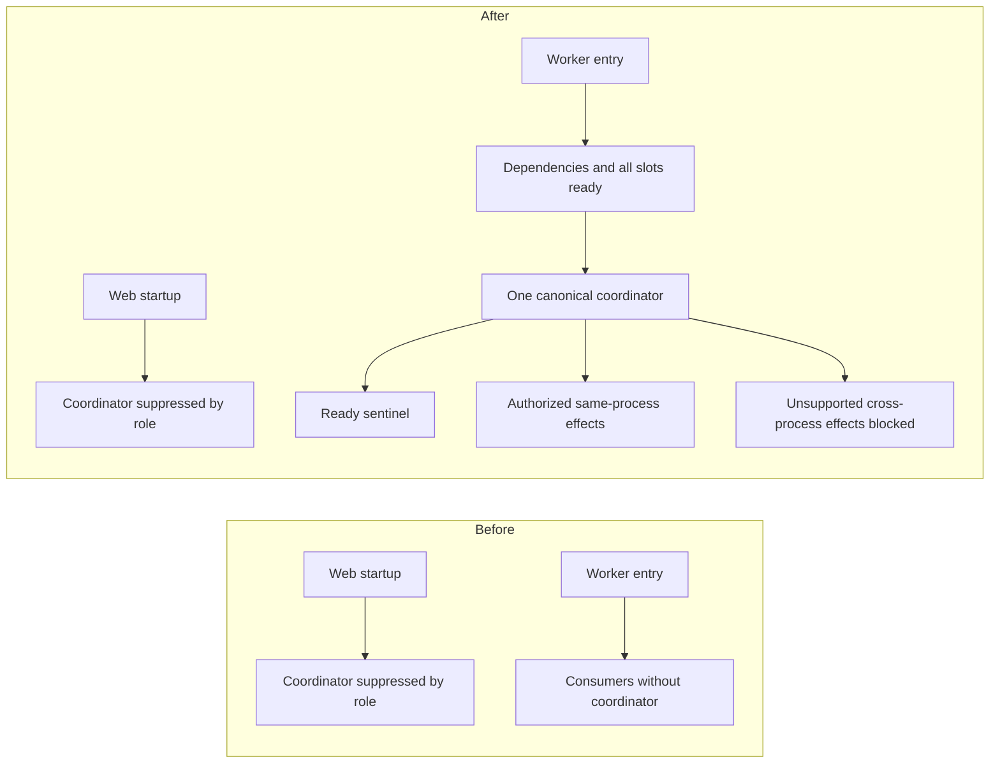

# Self-healing Worker bootstrap and ownership repair

Date: 2026-10-14. Repository: `pbjustin/Arcanos`.

- Audited source/base: `7aee3bb9ace55e1fc19f1e83d0b6dfeca169c383`.
- Safety reference: merged PR #1539, final synthetic-verification head
  `031cf38acea5f022a867bf3e0899fc3584a80c21`.
- Tested repair source: `489aa313f48c8bbb6e70f00d7b74958e2d5aec8c`, including
  the final controller-cancellation repair. The subsequent documentation commit
  and exact PR head are recorded in the draft PR; its executable source and
  tests match this commit.
- Scope: source repair and local/synthetic verification. Live acceptance is
  **NOT_RUN**; production promotion is **NOT_AUTHORIZED**.

## Confirmed findings and repairs

1. The normal integrity wrapper invokes `scripts/start-railway-service.mjs`.
   Its explicit web role starts `dist/start-server.js`; its worker role starts
   `dist/workers/jobRunner.js`. The server called the canonical coordinator,
   while explicit web-role policy suppressed it. The dedicated Worker's guarded
   entry point started consumers without that coordinator. This left the split
   production topology without the intended scheduler. `app.ts` did not supply
   a hidden alternative; `controlLoop` is retired and V2 has no second timer.
2. `runJobWorker()` now starts the existing canonical scheduler after database,
   autonomy, module registry and all-consumer dispatcher readiness, before the
   ready sentinel. An installation failure rejects bootstrap. The production
   entry guard still invokes this same body and handles failure with process
   exit. No independent healing controller was introduced.
3. Worker startup now initializes the existing Redis lifecycle and primes
   existing self-heal telemetry. An unstarted lifecycle previously could not
   expose configured shared-store failure to the kill switch. A configured
   unavailable store now restricts healing to frozen/autonomy 0 without adding
   a Redis dependency to queue readiness.
4. Coordinator initialization is idempotent; interval work and manual ticks
   share the in-flight fence. Shutdown clears the timer, propagates cancellation
   and drains the scheduled evaluation before stopping telemetry/Redis. Existing
   queue claims, heartbeat, lease recovery and all-slot readiness remain in
   their owning lifecycle. Tick failure is reported and can recover without
   poisoning job processing.
5. Canonical reactive and predictive effects now enforce enabled daemon mode,
   configured and effective autonomy at least 3, and both freeze controls false.
   Predictive execution also requires enabled prediction and server dry-run off;
   automatic execution requires its additional flag. Authorization is checked
   after asynchronous diagnosis. Production Trinity failure and prompt-timeout
   consumers consult effective shared safety controls before automatic activation.
   Malformed dry-run values now retain the safe default instead of granting
   execution. Flag and alias precedence has deterministic coverage.
6. Prompt-route state cannot reach a web consumer from the dedicated Worker.
   That action now returns `cross_process_prompt_route_unavailable`. The
   EventEmitter listener repair/scale/recycle controls do not own `jobRunner`
   and are unavailable there. Local provider and Trinity effects remain usable
   only for same-process consumers; stale-job recovery retains shared database
   ownership fences. No cross-service success is fabricated.
7. Structured lifecycle events and authenticated inspection distinguish actual
   scheduling and observation from configured intention. A tick timestamp alone
   is no longer proof of a successful observation. Current-process inspection
   cannot attest to a remote coordinator and reports that state as `UNKNOWN`.
8. A refused or throwing repair cannot fall through to a different controller
   effect in the same tick. Existing bounded escalation remains possible on a
   later tick after a recorded dispatch, without duplicate dispatch.
9. Final read-only review found that scheduled fallback `runSelfImproveCycle`
   did not receive cancellation, so an awaited operation could settle after
   shutdown and allow a later freeze, reflection, provider, PR or evidence effect.
   The canonical loop now forwards an optional signal. Controller entry and
   post-await checks prevent subsequent effects, and its catch rethrows
   cancellation before further evidence writing. Already-dispatched dependency
   I/O still drains cooperatively; this does not claim force cancellation inside
   third-party operations. Six deterministic cases extend the existing
   controller-decision suite; focused verification passes 4 suites / 128 tests.

Source owners: `src/workers/jobRunner.ts`, `src/server.ts`,
`src/services/selfImprove/selfHealingLoop.ts`,
`src/services/selfImprove/controller.ts`,
`src/services/selfImprove/predictiveHealingService.ts`,
`src/services/selfImprove/selfHealingV2.ts`,
`src/services/openai/promptRouteMitigation.ts`,
`src/services/selfImprove/workerRepairActuator.ts`,
`src/services/selfHealRuntimeInspectionService.ts`, `src/routes/safety.ts`,
`src/core/logic/trinity.ts`, `src/transport/http/controllers/openaiController.ts`
and `src/platform/runtime/unifiedConfig.ts`.

## Production inventory and unknown running state

The source establishes the missing Worker bootstrap call; it does not prove
which historical production incidents resulted from it. A fresh read-only
Railway connector inspection verified the Arcanos project, production environment,
`ARCANOS Worker` service and repository source. Direct service configuration and
fully rendered variable-name inventory agree: three requested names are present,
the other six are absent, and none of the requested flags is supplied by the
environment's shared variables. The service configuration reports one Worker
replica and no staged changes. OAuth reports `valuesRedacted=true`, so the three
present values are withheld and remain **UNKNOWN** here.

| Requested setting | Current Railway inventory / provenance | Actual value | Source fallback if absent |
| --- | --- | --- | --- |
| `ARCANOS_PROCESS_KIND` | Present in direct and rendered service inventory | Withheld / UNKNOWN | No launcher default; explicit role required |
| `RUN_WORKERS` | Present in direct and rendered service inventory | Withheld / UNKNOWN | `true` outside tests, `false` in tests; explicit role overrides it |
| `SELF_IMPROVE_ENABLED` | Absent from rendered and shared inventory | No configured entry | `false` |
| `SELF_IMPROVE_ACTUATOR_MODE` | Present in direct and rendered service inventory | Withheld / UNKNOWN | `pr_bot` |
| `SELF_IMPROVE_AUTONOMY_LEVEL` | Absent from rendered and shared inventory | No configured entry | `0` |
| `SELF_IMPROVE_FREEZE` | Absent from rendered and shared inventory | No configured entry | `false` |
| `PREDICTIVE_HEALING_ENABLED` | Absent from rendered and shared inventory | No configured entry | `false` |
| `PREDICTIVE_HEALING_DRY_RUN` | Absent from rendered and shared inventory | No configured entry | `true` |
| `PREDICTIVE_AUTO_EXECUTE` | Absent from rendered and shared inventory | No configured entry | `false` |

The inspected names `RAILWAY_PREDICTIVE_HEALING_ENABLED`,
`RAILWAY_PREDICTIVE_HEALING_DRY_RUN`, `PREDICTIVE_DRY_RUN`,
`RAILWAY_PREDICTIVE_AUTO_EXECUTE`, `AUTO_EXECUTE_HEALING`,
`RAILWAY_AUTO_EXECUTE_HEALING` and `RAILWAY_PREDICTIVE_DRY_RUN` are also absent.
Thus the six missing settings are absent in the rendered Railway inventory,
rather than inherited from its shared variables. The source fallback column is
separate evidence: no process execution, logs or probes were used to verify the
currently running revision's effective configuration or shared runtime overrides.
Those values and actual coordinator state remain **UNKNOWN**. No Railway
configuration was mutated. Before PR publication, a read-only Railway API query
also confirmed `prDeploys=false` for both accessible projects, `Arcanos` and
`Arcanos Live PR 1527`; no provider-native PR environment is enabled there.

## Ownership and configuration



The maintained [configuration matrix](../../../../CONFIGURATION.md#self-healing-coordinator-and-execution-policy)
documents all nine requested settings, defaults, aliases and policy for
observation, diagnosis, recommendations, local mitigation, predictive execution
and privileged repair. Missing self-improvement flags remain disabled, `pr_bot`,
autonomy 0; predictive defaults remain disabled, dry-run true and auto-execute
false. The freeze default alone never grants execution. Role determines
`RUN_WORKERS`, and inherited environment takes precedence over local `.env`.

The [action-to-process matrix](../../../../PREDICTIVE_SELF_HEALING.md#action-and-process-ownership)
documents detection, target/state owner, authorization, delivery, recovery and
expiry for provider, Trinity, prompt, stale-job, listener, remote and unsupported
traffic-shift actions. The existing exact-target worker-helper/privileged
approval boundary remains intact; it is not a cross-process prompt transport or
a dedicated Worker restart API.

PR #1539 guarantees retained: dispatch attempt/cooldown accounting, rejected
preflight accounting, mitigation identity fences, bounded failed-consumer
accounting, TTLs, route-attributed fresh post-action observations, matching
consumer/provider receipts, stale-evidence rejection and replacement-safe
rollback. A reload receipt, HTTP health, cached reply or unrelated route does
not prove recovery.

## Synthetic scenario inventory

The entries below identify real production bodies versus component fixtures.
External providers and production database/network boundaries are substituted.
Clocks are mostly injected; local SDK/transport integration uses some real timing
against synthetic endpoints. None establishes live acceptance.

| # | Required scenario | Deterministic coverage and boundary |
| --- | --- | --- |
| 1 | Web suppresses canonical loop | `server-startup-resilience.test.ts` invokes actual `startServer`; lifecycle integration also checks role suppression. |
| 2 | Worker starts canonical loop | `self-healing-worker-bootstrap.integration.test.ts` invokes exported `runJobWorker`, the same body used by the guarded production entry point. |
| 3 | One coordinator per Worker startup | Worker-bootstrap fixture executes actual all-consumer readiness and observes one canonical scheduler. |
| 4 | Repeated initialization idempotent | `self-healing-coordinator-lifecycle.integration.test.ts` repeats real scheduler initialization after the actual readiness barrier. |
| 5 | Shutdown stops evaluations | Worker-bootstrap fixture invokes installed SIGTERM callback; lifecycle fixture aborts/drains in-flight observation and advances fake time. Existing controller-decision tests cover pre-abort, cancellation during autonomy/freeze reads, reflection completion, and provider resolve/reject, preventing later PR/evidence effects. |
| 6 | Startup failure without false readiness | Both bootstrap/lifecycle suites reject timer-installation failure before the production ready sentinel. |
| 7 | Disabled flags cannot act | `unified-config.predictive-flags.test.ts`, `self-healing-loop.test.ts` and predictive-execution fixtures cover defaults and disabled execution. |
| 8 | Frozen/low autonomy cannot act | Reactive/predictive fixtures plus actual Trinity and prompt consumers test configured and effective restrictions; Worker bootstrap proves configured degraded Redis freezes effects while claims continue. |
| 9 | Predictive dry-run cannot mutate | `predictive-healing-execution.test.ts` rejects caller override; config fixtures preserve malformed/absent dry-run safety. |
| 10 | Unauthorized remote repair rejected | `worker-repair-actuator.test.ts` asserts absent approval prevents fetch; existing self-heal security fixtures preserve authenticated execution scopes. |
| 11 | Local effect reaches actual consumer | `prompt-route-mitigation.test.ts` exercises authorized same-process prompt policy; `self-healing-trinity.integration.test.ts` runs actual controller activation and consumers. |
| 12 | Cross-process false success rejected | Predictive, synthetic-controller, prompt and worker-actuator suites reject dedicated Worker prompt/listener actions. |
| 13 | Provider outage bounded | Synthetic-controller cooldown/attempt/escalation cases and real Trinity consumer over mocked transport bound sustained failures. |
| 14 | Worker retry and ownership fencing | `self-healing-worker-synthetic.integration.test.ts` runs actual consumer code with deterministic shared-ledger adapter: bounded retry, stale completion, lost first heartbeat and unavailable claim admission. |
| 15 | Recovery requires fresh evidence | Trinity integration requires actual matching consumer/provider receipts plus fresh route traffic; synthetic-controller fixtures enforce thresholds. |
| 16 | Stale evidence rejected | Synthetic-controller rejects pre-command same-clock, missing, unrelated, health-only and diagnostic-only samples. |
| 17 | Mitigation expires | `self-healing-v2.test.ts`, prompt mitigation and Trinity integration advance clocks through existing TTLs. |
| 18 | Replacement rollback safe | Prompt, V2, synthetic-controller and Trinity integration reject old outcomes/rollback after newer command installation. |
| 19 | Concurrent ticks serialized | Synthetic-controller and lifecycle integration hold an evaluation pending and reject overlapping ticks/restart while draining. |
| 20 | Controller failure/recovery preserves queue | Actual `runJobWorker` completes one fenced partition job while its coordinator is FAILED, then the coordinator recovers without a duplicate job effect. Worker-bootstrap/worker-synthetic verification passes 2 suites / 7 tests; lifecycle coverage also reports FAILED then RUNNING. |

Entry-path limits: the Worker fixture calls the real guarded entry body rather
than spawning the literal compiled integrity wrapper/launcher chain. It invokes
the installed signal callback rather than delivering an OS signal. Database,
autonomy persistence, Notion, transports and Redis networking are substituted;
it does not prove PostgreSQL locking, Redis connectivity, OS termination or
Railway orchestration. The existing local launcher/preview suites provide
separate contract coverage, not live Worker recovery. No generic live-verifier
infrastructure was added.

## Commands and results

Toolchain: Node `24.18.1`, npm `11.16.0`; Python `3.11.7`. Commands ran at the
repository root unless noted. Results below are local evidence, and overlapping
focused runs must not be summed into a unique test count. Final head-wide checks
must be refreshed after all edits; pending rows are not passes. The full root
command below ran with `CI=true`, `DISABLE_EXTERNAL_CALLS=true` and
`FORCE_MOCK=true`.
The historical 23-suite and first two full-root runs precede the final
controller-cancellation repair. The final combined focused run covers that repair.

| Command | Result |
| --- | --- |
| `npm ci` | PASS; 897 packages added. Existing audit summary: 52 vulnerabilities (4 moderate, 47 high, 1 critical); no dependency remediation in this repair. |
| `npm run type-check` | PASS after final controller-cancellation repair. |
| `npm run build` | PASS after final controller-cancellation repair. |
| `npm run lint` | PASS after final controller-cancellation repair, 0 errors / 77 warnings. |
| `npm run validate:railway` | PASS local static validation; no deployment. |
| `node scripts/run-jest.mjs --runTestsByPath tests/unified-config.predictive-flags.test.ts --coverage=false --runInBand` | PASS 1 suite / 28 tests. |
| `node scripts/run-jest.mjs --runTestsByPath tests/self-healing-worker-bootstrap.integration.test.ts tests/self-healing-coordinator-lifecycle.integration.test.ts --coverage=false` | PASS 2 suites / 10 tests after Redis integration. |
| Previous command plus `tests/server-startup-resilience.test.ts tests/job-runner-runtime.test.ts tests/self-healing-worker-synthetic.integration.test.ts` | PASS 5 suites / 70 tests in combined lifecycle regression run. |
| `node scripts/run-jest.mjs --runTestsByPath tests/prompt-route-mitigation.test.ts tests/worker-repair-actuator.test.ts tests/predictive-healing-execution.test.ts tests/predictive-healing-service.test.ts tests/self-healing-v2.test.ts tests/openai-prompt.test.ts tests/self-healing-synthetic-controller.integration.test.ts tests/self-healing-trinity.integration.test.ts tests/trinity-cancellation.test.ts --coverage=false --runInBand --silent` | PASS 9 suites / 177 tests, 6.458 s. |
| `node scripts/run-jest.mjs --runTestsByPath <first 22 exact test files listed below> --coverage=false --runInBand --json --outputFile=C:/Users/pbjus/.codex/tmp/self-heal-focused-final.json` | PASS 22 suites / 385 tests, 0 failures; earlier combined evidence retained. |
| `node scripts/run-jest.mjs --runTestsByPath <all 23 exact test files listed below> --coverage=false --runInBand --json --outputFile=C:/Users/pbjus/.codex/tmp/self-heal-focused-head.json` | PASS 23 suites / 387 tests, 0 failures, 21.973 s; includes the corrected restart fixture. |
| `node scripts/run-jest.mjs --runTestsByPath tests/self-improve-controller-decisions.test.ts tests/self-healing-loop.test.ts tests/self-healing-synthetic-controller.integration.test.ts tests/self-healing-coordinator-lifecycle.integration.test.ts --coverage=false --runInBand --silent` | PASS 4 suites / 128 tests, 6.362 s after controller-cancellation repair; `self-heal-controller-cancellation-focused.log`. |
| Final focused command below | PASS 24 suites / 404 tests, 0 failures, 22.923 s after all source and test edits; `self-heal-focused-cancellation.json`. |
| Focused Worker-bootstrap and worker-synthetic suites | PASS 2 suites / 7 tests after strengthening the failed-coordinator queue-completion assertion. |
| `npm test -- --maxWorkers=6 --workerIdleMemoryLimit=768MB --json --outputFile=C:/Users/pbjus/.codex/tmp/self-heal-full-test-final.json` | FAIL: 915 passed / 13 skipped / 2 failed suites; 18,092 passed / 165 skipped / 6 failed tests, 18,263 total, 362.306 s. Four unchanged Windows receipt/symlink failures and two Windows ESM restart-fixture failures; original evidence retained below. |
| `npm test -- --maxWorkers=6 --workerIdleMemoryLimit=768MB --json --outputFile=C:/Users/pbjus/.codex/tmp/self-heal-full-test-head.json` | FAIL after restart fixture repair: 916 passed / 13 skipped / 1 failed suites; 18,094 passed / 165 skipped / 4 failed tests, 18,263 total, 388.065 s. Only the unchanged Windows receipt/symlink failures remain. This run precedes the final controller-cancellation repair. |
| `npm test -- --maxWorkers=6 --workerIdleMemoryLimit=768MB --json --outputFile=C:/Users/pbjus/.codex/tmp/self-heal-full-test-cancellation.json` | Final source FAIL: 916 passed / 13 skipped / 1 failed suites; 18,100 passed / 165 skipped / 4 failed tests, 18,269 total, 382.259 s. Only the four unchanged Windows receipt/symlink failures remain; all healing and cancellation tests pass. |
| `npm run test:runtime-integration` | PASS 79 tests / 7 suites. |
| `npm run test:preview-e2e` | PASS 18 tests. |
| `npm run test:native-pr-preview-e2e` | PASS 42 tests. |
| `npm run test:live-pr-preview:offline` | PASS 16 tests; no hosted preview invoked. |
| `npm run test:model-policy:app:e2e` | PASS 4 tests against the compiled local application. |
| `npm run test:heartbeat:app:e2e` | PASS 6 tests against the compiled local application. |
| `npm run test:live-validation:offline` | FAIL 86 passed / 15 failed of 101: Windows symlink, POSIX spawn, CRLF regex, Git null-device and mode-bit assumptions; retained platform blockers. |
| `npm run test:stacked-draft-preview` | FAIL 115 passed / 20 failed of 135: Windows symlink/POSIX-shell/umask/npm-spawn assumptions; retained, not suppressed. See safety note below. |
| `python daemon-python/validate_backend_cli_offline.py` | PASS. |
| `python -m pytest daemon-python/tests/ -q --cov=daemon-python/arcanos --cov-report=xml:C:/Users/pbjus/.codex/tmp/self-heal-python-coverage.xml` | PASS 965 / 18 existing skips, 25.61 s with nonhidden task temp. |
| `npm run validate:backend-cli:contract` | PASS. |
| `npm run reindex` and `npm run reindex:check` | PASS; coupled inventories regenerated, 2,045 TypeScript / 271 Python files. |
| Staged `npm run guard:commit` and `git diff --check` | PASS for source commit; commit-hook `sync:check` reports 0 errors / 0 warnings / 5 informational entries. |
| `npm run docs:check` | PASS 1,064 checks, 0 failures / warnings; generated indexes current. |
| `npm run docs:links -- --local-only` | PASS 728 local targets, 0 failures across 153 maintained Markdown files; external network checks skipped. |
| `git diff --check` | PASS after documentation updates. |

Final focused command (PowerShell line continuations); the earlier 23-suite run
excluded the controller-decisions file, and the 22-suite run also excluded restart:

```powershell
node scripts/run-jest.mjs --runTestsByPath `
  tests/self-healing-security-synthetic.integration.test.ts tests/self-heal.runtime.route.test.ts `
  tests/self-heal-control-loop-startup.test.ts tests/self-heal-auth-composition.test.ts `
  tests/server-startup-resilience.test.ts tests/self-healing-loop.test.ts `
  tests/self-healing-trinity.integration.test.ts tests/openai-prompt.test.ts `
  tests/self-healing-worker-synthetic.integration.test.ts tests/job-runner-runtime.test.ts `
  tests/safety-self-heal.route.test.ts tests/self-healing-worker-bootstrap.integration.test.ts `
  tests/trinity-cancellation.test.ts tests/unified-config.predictive-flags.test.ts `
  tests/safety-self-heal-status.test.ts tests/predictive-healing-service.test.ts `
  tests/predictive-healing-execution.test.ts tests/self-healing-v2.test.ts `
  tests/self-healing-synthetic-controller.integration.test.ts tests/worker-repair-actuator.test.ts `
  tests/self-healing-coordinator-lifecycle.integration.test.ts tests/prompt-route-mitigation.test.ts `
  tests/self-healing-restart.test.js tests/self-improve-controller-decisions.test.ts `
  --coverage=false --runInBand --json `
  --outputFile=C:/Users/pbjus/.codex/tmp/self-heal-focused-cancellation.json
```

Retained failure evidence (local `self-heal-*.log` files, not secret-bearing logs
committed to the repository):

The controller-cancellation gap was a final code-review finding, not an observed
test failure or live incident. The new regression cases pass; earlier green runs
did not exercise this missing propagation boundary.

- Initial parent focused run failed 5/85: four exposed same-tick fallback after
  refused/throwing repair once fixtures had explicit authorization; one expected
  healthy inspection without observation. Production fixes preserve the original
  safety assertions and subsequent focused checks pass.
- Lifecycle fixture initially had a duplicate declaration (zero tests), then
  eight setup/fake-clock failures: environment had been set after diagnostics
  import and faked `setImmediate` stalled two readiness cases. Corrected fixture
  order and real `setImmediate` produced 8/8; actual Worker-body cases passed
  2/2 initially and after Redis initialization.
- Mitigation tests initially failed 7/104 because previously authorized success
  fixtures omitted the newly required flags. Intermediate 1/138 reason mismatch
  and 1/138 escalation failures were resolved. A later 12/177 fixture run used a
  5,000 ms synthetic hold beyond the existing 2,000 ms maximum, cascading through
  the breaker, and omitted cancellation-fixture autonomy. Bounded fixture values
  and explicit synthetic authorization restored 177/177 without deleting tests.
- Initial full root run was interrupted while fixtures were still changing;
  preserved output includes Trinity/cancellation failures. It is not a completed
  flaky-pass claim. The completed full run is reported separately above. Four
  failures occur in unchanged
  `railway-production-readonly-inspection.test.js`: existing receipt-directory
  validation accepts POSIX absolute paths only, and Windows symlink creation
  returns `EPERM`. Its two `self-healing-restart.test.js` failures are Windows
  ESM file-URL construction in the test harness. Fixing that exposed two further
  fixture failures because Windows Node injects 11 operating-system environment
  names into the child, contrary to the existing exact allowlist assertion. The
  fixture now deletes non-allowlisted names before importing production code,
  without broadening the assertion. The corrected restart fixture passes 2/2
  and the combined focused run passes 23 suites / 387 tests. The completed full
  rerun also passes both restart tests and retains only the four unchanged
  platform failures. The original six full-run failures and intermediate two restart
  failures remain recorded; no assertion is suppressed.
- Initial Python run had 957 pass / 18 skip / 8 failures because the task temp
  under hidden `.codex` triggered the repository tools' existing hidden-path
  exclusion. An unchanged-source rerun under a nonhidden temp passed 965/18.
- Windows stacked-preview tests failed to intercept a POSIX Docker shell stub;
  a real `docker login ghcr.io` attempted authentication using the synthetic
  fixture token and was denied. Its actual `finally` also ran
  `docker logout ghcr.io`, which may have cleared pre-existing local GHCR
  credentials; their prior state is unknown. No credential inspection, restore
  or retry was attempted. Login rejection prevented tag/push, and no successful
  login, deployment or provisioning occurred. The suite was not rerun; this
  harness isolation gap and possible local credential impact remain evidence
  and must be resolved before relying on that suite on Windows.

## Remaining risks and production prerequisites

- FULL_CI is not established by a green base commit or selected tests. Base
  `7aee3bb...` has a successful GitHub `All Checks Complete` run
  `38539078823`; that result does not transfer to the repaired head. Final root,
  required service-backed tests and platform-blocked checks need explicit final
  outcomes. The final local full root run retains four Windows platform failures;
  final-head GitHub results are recorded in the draft PR. Do not mark MERGE_READY PASS while any required non-live gate lacks
  a pass at the final PR head.
- Local in-memory telemetry does not aggregate web and Worker replicas. No
  secure purpose-bound transport for web prompt/Trinity mitigation was found;
  those cross-process effects remain unavailable. Remote coordinator inspection
  remains `UNKNOWN`; absence of evidence must not become a healthy state.
- Coordinator singleton ownership is per Node process, not a distributed leader
  election. The inspected Worker configuration has one replica; review ownership
  and shared-action concurrency before any separately authorized replica scaling.
- Cooperative cancellation prevents later effects after awaited work settles,
  including the fallback controller; it cannot force-abort already-dispatched
  dependency I/O or prove real lease recovery under process termination.
  The existing 60-second outer drain and
  queue ownership behavior still need a separately approved deployment rehearsal.
- Existing dependency audit findings and 77 lint warnings are not repaired by
  this focused change. Windows harness failures are retained, not waived.
- Any future promotion requires owner authorization, exact head/check refresh,
  review of effective configuration and shared overrides, preserved deployment
  holds, verified Worker-first then web rollout, readiness and sole-active
  deployment evidence, coordinator started/observation evidence, and approved
  live recovery criteria. Do not elevate autonomy, disable dry-run, enable
  automatic execution or restart production as part of this repair.
- Repository PR lifecycle code requires open, non-draft, main-targeted and
  `railway-preview`-labelled PRs for reconciliation; a draft without that label
  returns before constructing the Railway client. Production auto-deploy requires
  a successful default-branch push or an explicit authorized dispatch. Keep this
  PR draft and unlabelled for preview. Read-only project configuration confirms
  native `prDeploys=false` in both accessible ARCANOS projects; no setting was
  changed to publish this draft.

## Final gates

| Gate | Local result; final-head CI remains separate |
| --- | --- |
| CODE_REPAIR | PASS local; final source type-check/build/lint and focused regression pass |
| WORKER_BOOTSTRAP | PASS local synthetic; actual entry body and readiness failure covered |
| SINGLE_CONTROLLER_OWNERSHIP | PASS local synthetic; idempotency, concurrent ticks and cancellation covered |
| CONFIGURATION_POLICY | PASS local; 28 focused config tests and shared-control checks |
| CROSS_PROCESS_EFFECT_SAFETY | PASS local synthetic; unsupported targets denied and actual local consumers exercised |
| SYNTHETIC_ACCEPTANCE | PASS local for the 20 mapped scenarios; final 24 suites / 404 tests including controller cancellation, restart and strengthened queue fixture pass; no live claim |
| SECURITY_REGRESSION | PASS focused local authorization, approval, TTL and ownership-fencing checks; broader platform failures retained |
| FULL_CI | BLOCKED / incomplete; platform failures retained |
| MERGE_READY | NOT_PASS until every required non-live gate passes |
| LIVE_ACCEPTANCE | NOT_RUN |
| PRODUCTION_PROMOTION | NOT_AUTHORIZED |
