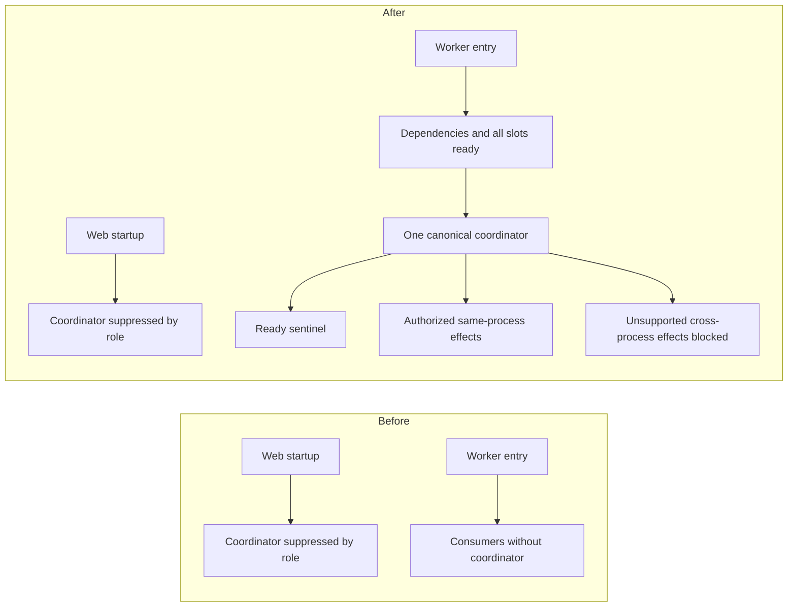

# Self-healing Worker bootstrap and ownership repair

Date: 2026-10-14. Repository: `pbjustin/Arcanos`.

The newer [PR #1544 sealed Railway acceptance preflight](#sealed-railway-acceptance-preflight--pr-1544)
below is **BLOCKED before deployment**. Its mandatory deployed acceptance gates
supersede the earlier task's synthetic-policy merge-readiness verdict for this
request; historical receipts below remain unchanged.

The original bootstrap audit and failure receipts below are retained as historical
evidence. The [final review](#final-review-and-blocker-repair) records the later
review, repairs and current readiness decision.

- Audited source/base: `7aee3bb9ace55e1fc19f1e83d0b6dfeca169c383`.
- Safety reference: merged PR #1539, final synthetic-verification head
  `031cf38acea5f022a867bf3e0899fc3584a80c21`.
- Tested repair source: `489aa313f48c8bbb6e70f00d7b74958e2d5aec8c`, including
  the final controller-cancellation repair. The subsequent documentation commit
  and exact PR head are recorded in the draft PR; its executable source and
  tests match this commit.
- Scope: source repair and local/synthetic verification. Live acceptance is
  **NOT_RUN**; production promotion is **NOT_AUTHORIZED**.

## Confirmed findings and repairs

1. The normal integrity wrapper invokes `scripts/start-railway-service.mjs`.
   Its explicit web role starts `dist/start-server.js`; its worker role starts
   `dist/workers/jobRunner.js`. The server called the canonical coordinator,
   while explicit web-role policy suppressed it. The dedicated Worker's guarded
   entry point started consumers without that coordinator. This left the split
   production topology without the intended scheduler. `app.ts` did not supply
   a hidden alternative; `controlLoop` is retired and V2 has no second timer.
2. `runJobWorker()` now starts the existing canonical scheduler after database,
   autonomy, module registry and all-consumer dispatcher readiness, before the
   ready sentinel. An installation failure rejects bootstrap. The production
   entry guard still invokes this same body and handles failure with process
   exit. No independent healing controller was introduced.
3. Worker startup now initializes the existing Redis lifecycle and primes
   existing self-heal telemetry. An unstarted lifecycle previously could not
   expose configured shared-store failure to the kill switch. A configured
   unavailable store now restricts healing to frozen/autonomy 0 without adding
   a Redis dependency to queue readiness.
4. Coordinator initialization is idempotent; interval work and manual ticks
   share the in-flight fence. Shutdown clears the timer, propagates cancellation
   and drains the scheduled evaluation before stopping telemetry/Redis. Existing
   queue claims, heartbeat, lease recovery and all-slot readiness remain in
   their owning lifecycle. Tick failure is reported and can recover without
   poisoning job processing.
5. Canonical reactive and predictive effects now enforce enabled daemon mode,
   configured and effective autonomy at least 3, and both freeze controls false.
   Predictive execution also requires enabled prediction and server dry-run off;
   automatic execution requires its additional flag. Authorization is checked
   after asynchronous diagnosis. Production Trinity failure and prompt-timeout
   consumers consult effective shared safety controls before automatic activation.
   Malformed dry-run values now retain the safe default instead of granting
   execution. Flag and alias precedence has deterministic coverage.
6. Prompt-route state cannot reach a web consumer from the dedicated Worker.
   That action now returns `cross_process_prompt_route_unavailable`. The
   EventEmitter listener repair/scale/recycle controls do not own `jobRunner`
   and are unavailable there. Local provider and Trinity effects remain usable
   only for same-process consumers; stale-job recovery retains shared database
   ownership fences. No cross-service success is fabricated.
7. Structured lifecycle events and authenticated inspection distinguish actual
   scheduling and observation from configured intention. A tick timestamp alone
   is no longer proof of a successful observation. Current-process inspection
   cannot attest to a remote coordinator and reports that state as `UNKNOWN`.
8. A refused or throwing repair cannot fall through to a different controller
   effect in the same tick. Existing bounded escalation remains possible on a
   later tick after a recorded dispatch, without duplicate dispatch.
9. Final read-only review found that scheduled fallback `runSelfImproveCycle`
   did not receive cancellation, so an awaited operation could settle after
   shutdown and allow a later freeze, reflection, provider, PR or evidence effect.
   The canonical loop now forwards an optional signal. Controller entry and
   post-await checks prevent subsequent effects, and its catch rethrows
   cancellation before further evidence writing. Already-dispatched dependency
   I/O still drains cooperatively; this does not claim force cancellation inside
   third-party operations. Six deterministic cases extend the existing
   controller-decision suite; focused verification passes 4 suites / 128 tests.

Source owners: `src/workers/jobRunner.ts`, `src/server.ts`,
`src/services/selfImprove/selfHealingLoop.ts`,
`src/services/selfImprove/controller.ts`,
`src/services/selfImprove/predictiveHealingService.ts`,
`src/services/selfImprove/selfHealingV2.ts`,
`src/services/openai/promptRouteMitigation.ts`,
`src/services/selfImprove/workerRepairActuator.ts`,
`src/services/selfHealRuntimeInspectionService.ts`, `src/routes/safety.ts`,
`src/core/logic/trinity.ts`, `src/transport/http/controllers/openaiController.ts`
and `src/platform/runtime/unifiedConfig.ts`.

## Production inventory and unknown running state

The source establishes the missing Worker bootstrap call; it does not prove
which historical production incidents resulted from it. A fresh read-only
Railway connector inspection verified the Arcanos project, production environment,
`ARCANOS Worker` service and repository source. Direct service configuration and
fully rendered variable-name inventory agree: three requested names are present,
the other six are absent, and none of the requested flags is supplied by the
environment's shared variables. The service configuration reports one Worker
replica and no staged changes. OAuth reports `valuesRedacted=true`, so the three
present values are withheld and remain **UNKNOWN** here.

| Requested setting | Current Railway inventory / provenance | Actual value | Source fallback if absent |
| --- | --- | --- | --- |
| `ARCANOS_PROCESS_KIND` | Present in direct and rendered service inventory | Withheld / UNKNOWN | No launcher default; explicit role required |
| `RUN_WORKERS` | Present in direct and rendered service inventory | Withheld / UNKNOWN | `true` outside tests, `false` in tests; explicit role overrides it |
| `SELF_IMPROVE_ENABLED` | Absent from rendered and shared inventory | No configured entry | `false` |
| `SELF_IMPROVE_ACTUATOR_MODE` | Present in direct and rendered service inventory | Withheld / UNKNOWN | `pr_bot` |
| `SELF_IMPROVE_AUTONOMY_LEVEL` | Absent from rendered and shared inventory | No configured entry | `0` |
| `SELF_IMPROVE_FREEZE` | Absent from rendered and shared inventory | No configured entry | `false` |
| `PREDICTIVE_HEALING_ENABLED` | Absent from rendered and shared inventory | No configured entry | `false` |
| `PREDICTIVE_HEALING_DRY_RUN` | Absent from rendered and shared inventory | No configured entry | `true` |
| `PREDICTIVE_AUTO_EXECUTE` | Absent from rendered and shared inventory | No configured entry | `false` |

The inspected names `RAILWAY_PREDICTIVE_HEALING_ENABLED`,
`RAILWAY_PREDICTIVE_HEALING_DRY_RUN`, `PREDICTIVE_DRY_RUN`,
`RAILWAY_PREDICTIVE_AUTO_EXECUTE`, `AUTO_EXECUTE_HEALING`,
`RAILWAY_AUTO_EXECUTE_HEALING` and `RAILWAY_PREDICTIVE_DRY_RUN` are also absent.
Thus the six missing settings are absent in the rendered Railway inventory,
rather than inherited from its shared variables. The source fallback column is
separate evidence: no process execution, logs or probes were used to verify the
currently running revision's effective configuration or shared runtime overrides.
Those values and actual coordinator state remain **UNKNOWN**. No Railway
configuration was mutated. Before PR publication, a read-only Railway API query
also confirmed `prDeploys=false` for both accessible projects, `Arcanos` and
`Arcanos Live PR 1527`; no provider-native PR environment is enabled there.

## Ownership and configuration



The maintained [configuration matrix](../../../../CONFIGURATION.md#self-healing-coordinator-and-execution-policy)
documents all nine requested settings, defaults, aliases and policy for
observation, diagnosis, recommendations, local mitigation, predictive execution
and privileged repair. Missing self-improvement flags remain disabled, `pr_bot`,
autonomy 0; predictive defaults remain disabled, dry-run true and auto-execute
false. The freeze default alone never grants execution. Role determines
`RUN_WORKERS`, and inherited environment takes precedence over local `.env`.

The [action-to-process matrix](../../../../PREDICTIVE_SELF_HEALING.md#action-and-process-ownership)
documents detection, target/state owner, authorization, delivery, recovery and
expiry for provider, Trinity, prompt, stale-job, listener, remote and unsupported
traffic-shift actions. The existing exact-target worker-helper/privileged
approval boundary remains intact; it is not a cross-process prompt transport or
a dedicated Worker restart API.

PR #1539 guarantees retained: dispatch attempt/cooldown accounting, rejected
preflight accounting, mitigation identity fences, bounded failed-consumer
accounting, TTLs, route-attributed fresh post-action observations, matching
consumer/provider receipts, stale-evidence rejection and replacement-safe
rollback. A reload receipt, HTTP health, cached reply or unrelated route does
not prove recovery.

## Synthetic scenario inventory

The entries below identify real production bodies versus component fixtures.
External providers and production database/network boundaries are substituted.
Clocks are mostly injected; local SDK/transport integration uses some real timing
against synthetic endpoints. None establishes live acceptance.

| # | Required scenario | Deterministic coverage and boundary |
| --- | --- | --- |
| 1 | Web suppresses canonical loop | `server-startup-resilience.test.ts` invokes actual `startServer`; lifecycle integration also checks role suppression. |
| 2 | Worker starts canonical loop | `self-healing-worker-bootstrap.integration.test.ts` invokes exported `runJobWorker`, the same body used by the guarded production entry point. |
| 3 | One coordinator per Worker startup | Worker-bootstrap fixture executes actual all-consumer readiness and observes one canonical scheduler. |
| 4 | Repeated initialization idempotent | `self-healing-coordinator-lifecycle.integration.test.ts` repeats real scheduler initialization after the actual readiness barrier. |
| 5 | Shutdown stops evaluations | Worker-bootstrap fixture invokes installed SIGTERM callback; lifecycle fixture aborts/drains in-flight observation and advances fake time. Existing controller-decision tests cover pre-abort, cancellation during autonomy/freeze reads, reflection completion, and provider resolve/reject, preventing later PR/evidence effects. |
| 6 | Startup failure without false readiness | Both bootstrap/lifecycle suites reject timer-installation failure before the production ready sentinel. |
| 7 | Disabled flags cannot act | `unified-config.predictive-flags.test.ts`, `self-healing-loop.test.ts` and predictive-execution fixtures cover defaults and disabled execution. |
| 8 | Frozen/low autonomy cannot act | Reactive/predictive fixtures plus actual Trinity and prompt consumers test configured and effective restrictions; Worker bootstrap proves configured degraded Redis freezes effects while claims continue. |
| 9 | Predictive dry-run cannot mutate | `predictive-healing-execution.test.ts` rejects caller override; config fixtures preserve malformed/absent dry-run safety. |
| 10 | Unauthorized remote repair rejected | `worker-repair-actuator.test.ts` asserts absent approval prevents fetch; existing self-heal security fixtures preserve authenticated execution scopes. |
| 11 | Local effect reaches actual consumer | `prompt-route-mitigation.test.ts` exercises authorized same-process prompt policy; `self-healing-trinity.integration.test.ts` runs actual controller activation and consumers. |
| 12 | Cross-process false success rejected | Predictive, synthetic-controller, prompt and worker-actuator suites reject dedicated Worker prompt/listener actions. |
| 13 | Provider outage bounded | Synthetic-controller cooldown/attempt/escalation cases and real Trinity consumer over mocked transport bound sustained failures. |
| 14 | Worker retry and ownership fencing | `self-healing-worker-synthetic.integration.test.ts` runs actual consumer code with deterministic shared-ledger adapter: bounded retry, stale completion, lost first heartbeat and unavailable claim admission. |
| 15 | Recovery requires fresh evidence | Trinity integration requires actual matching consumer/provider receipts plus fresh route traffic; synthetic-controller fixtures enforce thresholds. |
| 16 | Stale evidence rejected | Synthetic-controller rejects pre-command same-clock, missing, unrelated, health-only and diagnostic-only samples. |
| 17 | Mitigation expires | `self-healing-v2.test.ts`, prompt mitigation and Trinity integration advance clocks through existing TTLs. |
| 18 | Replacement rollback safe | Prompt, V2, synthetic-controller and Trinity integration reject old outcomes/rollback after newer command installation. |
| 19 | Concurrent ticks serialized | Synthetic-controller and lifecycle integration hold an evaluation pending and reject overlapping ticks/restart while draining. |
| 20 | Controller failure/recovery preserves queue | Actual `runJobWorker` completes one fenced partition job while its coordinator is FAILED, then the coordinator recovers without a duplicate job effect. Worker-bootstrap/worker-synthetic verification passes 2 suites / 7 tests; lifecycle coverage also reports FAILED then RUNNING. |

Entry-path limits: the Worker fixture calls the real guarded entry body rather
than spawning the literal compiled integrity wrapper/launcher chain. It invokes
the installed signal callback rather than delivering an OS signal. Database,
autonomy persistence, Notion, transports and Redis networking are substituted;
it does not prove PostgreSQL locking, Redis connectivity, OS termination or
Railway orchestration. The existing local launcher/preview suites provide
separate contract coverage, not live Worker recovery. No generic live-verifier
infrastructure was added.

## Commands and results

Toolchain: Node `24.18.1`, npm `11.16.0`; Python `3.11.7`. Commands ran at the
repository root unless noted. Results below are local evidence, and overlapping
focused runs must not be summed into a unique test count. Final head-wide checks
must be refreshed after all edits; pending rows are not passes. The full root
command below ran with `CI=true`, `DISABLE_EXTERNAL_CALLS=true` and
`FORCE_MOCK=true`.
The historical 23-suite and first two full-root runs precede the final
controller-cancellation repair. The final combined focused run covers that repair.

| Command | Result |
| --- | --- |
| `npm ci` | PASS; 897 packages added. Existing audit summary: 52 vulnerabilities (4 moderate, 47 high, 1 critical); no dependency remediation in this repair. |
| `npm run type-check` | PASS after final controller-cancellation repair. |
| `npm run build` | PASS after final controller-cancellation repair. |
| `npm run lint` | PASS after final controller-cancellation repair, 0 errors / 77 warnings. |
| `npm run validate:railway` | PASS local static validation; no deployment. |
| `node scripts/run-jest.mjs --runTestsByPath tests/unified-config.predictive-flags.test.ts --coverage=false --runInBand` | PASS 1 suite / 28 tests. |
| `node scripts/run-jest.mjs --runTestsByPath tests/self-healing-worker-bootstrap.integration.test.ts tests/self-healing-coordinator-lifecycle.integration.test.ts --coverage=false` | PASS 2 suites / 10 tests after Redis integration. |
| Previous command plus `tests/server-startup-resilience.test.ts tests/job-runner-runtime.test.ts tests/self-healing-worker-synthetic.integration.test.ts` | PASS 5 suites / 70 tests in combined lifecycle regression run. |
| `node scripts/run-jest.mjs --runTestsByPath tests/prompt-route-mitigation.test.ts tests/worker-repair-actuator.test.ts tests/predictive-healing-execution.test.ts tests/predictive-healing-service.test.ts tests/self-healing-v2.test.ts tests/openai-prompt.test.ts tests/self-healing-synthetic-controller.integration.test.ts tests/self-healing-trinity.integration.test.ts tests/trinity-cancellation.test.ts --coverage=false --runInBand --silent` | PASS 9 suites / 177 tests, 6.458 s. |
| `node scripts/run-jest.mjs --runTestsByPath <first 22 exact test files listed below> --coverage=false --runInBand --json --outputFile=C:/Users/pbjus/.codex/tmp/self-heal-focused-final.json` | PASS 22 suites / 385 tests, 0 failures; earlier combined evidence retained. |
| `node scripts/run-jest.mjs --runTestsByPath <all 23 exact test files listed below> --coverage=false --runInBand --json --outputFile=C:/Users/pbjus/.codex/tmp/self-heal-focused-head.json` | PASS 23 suites / 387 tests, 0 failures, 21.973 s; includes the corrected restart fixture. |
| `node scripts/run-jest.mjs --runTestsByPath tests/self-improve-controller-decisions.test.ts tests/self-healing-loop.test.ts tests/self-healing-synthetic-controller.integration.test.ts tests/self-healing-coordinator-lifecycle.integration.test.ts --coverage=false --runInBand --silent` | PASS 4 suites / 128 tests, 6.362 s after controller-cancellation repair; `self-heal-controller-cancellation-focused.log`. |
| Final focused command below | PASS 24 suites / 404 tests, 0 failures, 22.923 s after all source and test edits; `self-heal-focused-cancellation.json`. |
| Focused Worker-bootstrap and worker-synthetic suites | PASS 2 suites / 7 tests after strengthening the failed-coordinator queue-completion assertion. |
| `npm test -- --maxWorkers=6 --workerIdleMemoryLimit=768MB --json --outputFile=C:/Users/pbjus/.codex/tmp/self-heal-full-test-final.json` | FAIL: 915 passed / 13 skipped / 2 failed suites; 18,092 passed / 165 skipped / 6 failed tests, 18,263 total, 362.306 s. Four unchanged Windows receipt/symlink failures and two Windows ESM restart-fixture failures; original evidence retained below. |
| `npm test -- --maxWorkers=6 --workerIdleMemoryLimit=768MB --json --outputFile=C:/Users/pbjus/.codex/tmp/self-heal-full-test-head.json` | FAIL after restart fixture repair: 916 passed / 13 skipped / 1 failed suites; 18,094 passed / 165 skipped / 4 failed tests, 18,263 total, 388.065 s. Only the unchanged Windows receipt/symlink failures remain. This run precedes the final controller-cancellation repair. |
| `npm test -- --maxWorkers=6 --workerIdleMemoryLimit=768MB --json --outputFile=C:/Users/pbjus/.codex/tmp/self-heal-full-test-cancellation.json` | Final source FAIL: 916 passed / 13 skipped / 1 failed suites; 18,100 passed / 165 skipped / 4 failed tests, 18,269 total, 382.259 s. Only the four unchanged Windows receipt/symlink failures remain; all healing and cancellation tests pass. |
| `npm run test:runtime-integration` | PASS 79 tests / 7 suites. |
| `npm run test:preview-e2e` | PASS 18 tests. |
| `npm run test:native-pr-preview-e2e` | PASS 42 tests. |
| `npm run test:live-pr-preview:offline` | PASS 16 tests; no hosted preview invoked. |
| `npm run test:model-policy:app:e2e` | PASS 4 tests against the compiled local application. |
| `npm run test:heartbeat:app:e2e` | PASS 6 tests against the compiled local application. |
| `npm run test:live-validation:offline` | FAIL 86 passed / 15 failed of 101: Windows symlink, POSIX spawn, CRLF regex, Git null-device and mode-bit assumptions; retained platform blockers. |
| `npm run test:stacked-draft-preview` | FAIL 115 passed / 20 failed of 135: Windows symlink/POSIX-shell/umask/npm-spawn assumptions; retained, not suppressed. See safety note below. |
| `python daemon-python/validate_backend_cli_offline.py` | PASS. |
| `python -m pytest daemon-python/tests/ -q --cov=daemon-python/arcanos --cov-report=xml:C:/Users/pbjus/.codex/tmp/self-heal-python-coverage.xml` | PASS 965 / 18 existing skips, 25.61 s with nonhidden task temp. |
| `npm run validate:backend-cli:contract` | PASS. |
| `npm run reindex` and `npm run reindex:check` | PASS; coupled inventories regenerated, 2,045 TypeScript / 271 Python files. |
| Staged `npm run guard:commit` and `git diff --check` | PASS for source commit; commit-hook `sync:check` reports 0 errors / 0 warnings / 5 informational entries. |
| `npm run docs:check` | PASS 1,064 checks, 0 failures / warnings; generated indexes current. |
| `npm run docs:links -- --local-only` | PASS 728 local targets, 0 failures across 153 maintained Markdown files; external network checks skipped. |
| `git diff --check` | PASS after documentation updates. |

Final focused command (PowerShell line continuations); the earlier 23-suite run
excluded the controller-decisions file, and the 22-suite run also excluded restart:

```powershell
node scripts/run-jest.mjs --runTestsByPath `
  tests/self-healing-security-synthetic.integration.test.ts tests/self-heal.runtime.route.test.ts `
  tests/self-heal-control-loop-startup.test.ts tests/self-heal-auth-composition.test.ts `
  tests/server-startup-resilience.test.ts tests/self-healing-loop.test.ts `
  tests/self-healing-trinity.integration.test.ts tests/openai-prompt.test.ts `
  tests/self-healing-worker-synthetic.integration.test.ts tests/job-runner-runtime.test.ts `
  tests/safety-self-heal.route.test.ts tests/self-healing-worker-bootstrap.integration.test.ts `
  tests/trinity-cancellation.test.ts tests/unified-config.predictive-flags.test.ts `
  tests/safety-self-heal-status.test.ts tests/predictive-healing-service.test.ts `
  tests/predictive-healing-execution.test.ts tests/self-healing-v2.test.ts `
  tests/self-healing-synthetic-controller.integration.test.ts tests/worker-repair-actuator.test.ts `
  tests/self-healing-coordinator-lifecycle.integration.test.ts tests/prompt-route-mitigation.test.ts `
  tests/self-healing-restart.test.js tests/self-improve-controller-decisions.test.ts `
  --coverage=false --runInBand --json `
  --outputFile=C:/Users/pbjus/.codex/tmp/self-heal-focused-cancellation.json
```

Retained failure evidence (local `self-heal-*.log` files, not secret-bearing logs
committed to the repository):

The controller-cancellation gap was a final code-review finding, not an observed
test failure or live incident. The new regression cases pass; earlier green runs
did not exercise this missing propagation boundary.

- Initial parent focused run failed 5/85: four exposed same-tick fallback after
  refused/throwing repair once fixtures had explicit authorization; one expected
  healthy inspection without observation. Production fixes preserve the original
  safety assertions and subsequent focused checks pass.
- Lifecycle fixture initially had a duplicate declaration (zero tests), then
  eight setup/fake-clock failures: environment had been set after diagnostics
  import and faked `setImmediate` stalled two readiness cases. Corrected fixture
  order and real `setImmediate` produced 8/8; actual Worker-body cases passed
  2/2 initially and after Redis initialization.
- Mitigation tests initially failed 7/104 because previously authorized success
  fixtures omitted the newly required flags. Intermediate 1/138 reason mismatch
  and 1/138 escalation failures were resolved. A later 12/177 fixture run used a
  5,000 ms synthetic hold beyond the existing 2,000 ms maximum, cascading through
  the breaker, and omitted cancellation-fixture autonomy. Bounded fixture values
  and explicit synthetic authorization restored 177/177 without deleting tests.
- Initial full root run was interrupted while fixtures were still changing;
  preserved output includes Trinity/cancellation failures. It is not a completed
  flaky-pass claim. The completed full run is reported separately above. Four
  failures occur in unchanged
  `railway-production-readonly-inspection.test.js`: existing receipt-directory
  validation accepts POSIX absolute paths only, and Windows symlink creation
  returns `EPERM`. Its two `self-healing-restart.test.js` failures are Windows
  ESM file-URL construction in the test harness. Fixing that exposed two further
  fixture failures because Windows Node injects 11 operating-system environment
  names into the child, contrary to the existing exact allowlist assertion. The
  fixture now deletes non-allowlisted names before importing production code,
  without broadening the assertion. The corrected restart fixture passes 2/2
  and the combined focused run passes 23 suites / 387 tests. The completed full
  rerun also passes both restart tests and retains only the four unchanged
  platform failures. The original six full-run failures and intermediate two restart
  failures remain recorded; no assertion is suppressed.
- Initial Python run had 957 pass / 18 skip / 8 failures because the task temp
  under hidden `.codex` triggered the repository tools' existing hidden-path
  exclusion. An unchanged-source rerun under a nonhidden temp passed 965/18.
- Windows stacked-preview tests failed to intercept a POSIX Docker shell stub;
  a real `docker login ghcr.io` attempted authentication using the synthetic
  fixture token and was denied. Its actual `finally` also ran
  `docker logout ghcr.io`, which may have cleared pre-existing local GHCR
  credentials; their prior state is unknown. No credential inspection, restore
  or retry was attempted. Login rejection prevented tag/push, and no successful
  login, deployment or provisioning occurred. The suite was not rerun; this
  harness isolation gap and possible local credential impact remain evidence
  and must be resolved before relying on that suite on Windows.

## Remaining risks and production prerequisites

- FULL_CI is not established by a green base commit or selected tests. Base
  `7aee3bb...` has a successful GitHub `All Checks Complete` run
  `38539078823`; that result does not transfer to the repaired head. Final root,
  required service-backed tests and platform-blocked checks need explicit final
  outcomes. The final local full root run retains four Windows platform failures;
  final-head GitHub results are recorded in the draft PR. Do not mark MERGE_READY PASS while any required non-live gate lacks
  a pass at the final PR head.
- Local in-memory telemetry does not aggregate web and Worker replicas. No
  secure purpose-bound transport for web prompt/Trinity mitigation was found;
  those cross-process effects remain unavailable. Remote coordinator inspection
  remains `UNKNOWN`; absence of evidence must not become a healthy state.
- Coordinator singleton ownership is per Node process, not a distributed leader
  election. The inspected Worker configuration has one replica; review ownership
  and shared-action concurrency before any separately authorized replica scaling.
- Cooperative cancellation prevents later effects after awaited work settles,
  including the fallback controller; it cannot force-abort already-dispatched
  dependency I/O or prove real lease recovery under process termination.
  The existing 60-second outer drain and
  queue ownership behavior still need a separately approved deployment rehearsal.
- Existing dependency audit findings and 77 lint warnings are not repaired by
  this focused change. Windows harness failures are retained, not waived.
- Any future promotion requires owner authorization, exact head/check refresh,
  review of effective configuration and shared overrides, preserved deployment
  holds, verified Worker-first then web rollout, readiness and sole-active
  deployment evidence, coordinator started/observation evidence, and approved
  live recovery criteria. Do not elevate autonomy, disable dry-run, enable
  automatic execution or restart production as part of this repair.
- Repository PR lifecycle code requires open, non-draft, main-targeted and
  `railway-preview`-labelled PRs for reconciliation; a draft without that label
  returns before constructing the Railway client. Production auto-deploy requires
  a successful default-branch push or an explicit authorized dispatch. Keep this
  PR draft and unlabelled for preview. Read-only project configuration confirms
  native `prDeploys=false` in both accessible ARCANOS projects; no setting was
  changed to publish this draft.

## Historical bootstrap gates

| Gate | Local result; final-head CI remains separate |
| --- | --- |
| CODE_REPAIR | PASS local; final source type-check/build/lint and focused regression pass |
| WORKER_BOOTSTRAP | PASS local synthetic; actual entry body and readiness failure covered |
| SINGLE_CONTROLLER_OWNERSHIP | PASS local synthetic; idempotency, concurrent ticks and cancellation covered |
| CONFIGURATION_POLICY | PASS local; 28 focused config tests and shared-control checks |
| CROSS_PROCESS_EFFECT_SAFETY | PASS local synthetic; unsupported targets denied and actual local consumers exercised |
| SYNTHETIC_ACCEPTANCE | PASS local for the 20 mapped scenarios; final 24 suites / 404 tests including controller cancellation, restart and strengthened queue fixture pass; no live claim |
| SECURITY_REGRESSION | PASS focused local authorization, approval, TTL and ownership-fencing checks; broader platform failures retained |
| FULL_CI | BLOCKED / incomplete; platform failures retained |
| MERGE_READY | NOT_PASS until every required non-live gate passes |
| LIVE_ACCEPTANCE | NOT_RUN |
| PRODUCTION_PROMOTION | NOT_AUTHORIZED |

## Final review and blocker repair

Review began against freshly fetched head
`85a1775ce193d280d4eac995a946485c7fb38a50` and base/merge-base
`7aee3bb9ace55e1fc19f1e83d0b6dfeca169c383`: three commits ahead, zero behind,
38 changed files, clean checkout. The supplied observed head was still current;
no intervening repair existed. Work used the existing
`fix/self-heal-worker-ownership` branch. The PR remains open, draft and unmerged.

### Verified defects and repair commits

| Commit | Defect and repair | Regression evidence |
| --- | --- | --- |
| `dc8a3b1c849f441b616e3c618d3c635d8687ee1f` | HTTP shutdown began coordinator drain and dependency teardown concurrently. Stop admission, await listener/coordinator/pending-startup drains, then telemetry/Redis/database; duplicate calls share completion and one deadline bounds all phases. An uncertified or expired drain forces unsuccessful process exit without racing explicit dependency teardown. | 17 server lifecycle tests; nine added cases cover held operations, duplicate calls, rejection/synchronous failure, timeout, cleanup timeout and partial startup. |
| `3b7167e7eafd9524f8ba5041fe92ae152f7ab85e` | Status reads mixed last-tick authority with current configuration. Preserve the stored mode/timestamp pair. Also recheck configuration after awaited shared controls, reject predictive observation-only takeover during diagnosis, and retain completed-effect verification before honoring cancellation. | 20 new loop unit cases and three integrated coordinator cases; policy/recovery/security selection passes 8 suites / 216 tests. Original new-regression failures retained. |
| `dd49b77d4d0144ca30cf26808f0cd1607655cb11` | Concurrent predictive requests passed cooldown before awaiting authorization and dispatched twice. Reserve the action after final authorization, recheck cooldown, hold ownership through settlement, release in `finally`, and charge uncertain thrown dispatches a cooldown. | 2 suites / 38 tests, including simultaneous policy reads, long-running overlap, failed-attempt retry and seven policy changes during authorization. |
| `f7589d6a78f5e6a9b28fc9b9facb432ba668c0c9` | Failed coordinator installation left queue consumers polling while dependencies closed. Abort process admission with an accurate failure reason, await every slot, then drain coordinators and clean resources. Preserve the original failure and clean partially installed timers. | 6 actual worker-bootstrap tests, including held slot-finalization, no later claims, aborted-process restart refusal, cleanup errors, telemetry rejection and non-RUNNING coordinator return. |
| `ae162fc7b38a3c973913b2c089e119e222c9d689` | Windows receipt validation assumed POSIX paths/modes/symlink privileges; publisher PATH interception could reach host Docker. Use native absolute paths, real junction fixtures and explicit restrictive-open assertions. A Node preloader denies external process/network APIs and positively records exact injected publisher commands. | Linux receipt 44/44, stacked-preview 136/136, live-validation 234/234, final publisher 10/10. The Windows CI job now runs the receipt and publisher fixtures. |
| `eadbb27d13da45e3caf9a2aad776dd5d7d6898fd` | The maintained startup guide still described concurrent dependency teardown. Align it with the repaired drain ordering and deadline. | Documentation validation. |
| `d53370a226427812b1f8bc8869a1a48f7fe6926d` | Full CI logs exceeded the connector response limit, obscuring exact test counts. Retain a bounded artifact and job summary containing exact-head Jest counters for both test selections. | Workflow YAML parses; test exit status, coverage upload and thresholds remain unchanged. |
| `e264bf5a487555111efc56c47f648d2aaab6d058` | The supply-chain test correctly rejected the changed receipt-writer digest. After independently reviewing the portable path and filesystem-adapter change, update the pinned digest. | All five supply-chain containment tests pass; the original full-run failure is retained. |

No execution flags/defaults, production permissions, coverage thresholds or
production-source coverage exclusions were relaxed. The independent review
inspected every original changed file, including all 13 production files,
the affected tests, configuration and maintained/generated documentation.
The generated-index command produced only timestamp changes; those incidental
timestamp edits were discarded after confirming no index-content drift.

### Review and Codecov evidence

The two inline CodeRabbit findings were verified against code, rather than
accepted solely from their suggested diffs:

- Shutdown ordering: thread `PRRT_kwDOPKkVZ86sQ5YW`,
  [comment 4269462199](https://github.com/pbjustin/Arcanos/pull/1544#discussion_r4269462199),
  repaired by `dc8a3b1c`.
- Historical operating mode: thread `PRRT_kwDOPKkVZ86sQ5Yp`,
  [comment 4269462232](https://github.com/pbjustin/Arcanos/pull/1544#discussion_r4269462232),
  repaired by `3b7167e7`.

The walkthrough's additional cancellation/verification concern was also valid
and repaired by `3b7167e7`. Completed effects retain evidence; cancellation still
prevents subsequent dispatch. Both findings were resolved after committing,
verifying and pushing their repairs; the
[shutdown reply](https://github.com/pbjustin/Arcanos/pull/1544#discussion_r4274185190)
and [policy reply](https://github.com/pbjustin/Arcanos/pull/1544#discussion_r4274185784)
record the associated regression evidence. Final review state is refreshed
again after the audit commit.

The actual [Codecov report](https://app.codecov.io/gh/pbjustin/Arcanos/pull/1544)
on the original head was **74.19355% (23/31 changed lines)**, with seven missed
and one partial line, against the repository's **80%** patch target. The report
had the correct base and a complete successful upload. Missing paths were the
worker telemetry rejection, non-RUNNING start guard, optional recovery count and
literal entrypoint. Meaningful worker fixtures cover the important missing
failure branches; no instrumentation repair or policy exception was justified.
Only `jobRunner.ts` among this PR's changed production modules belonged to the
pre-existing explicit coverage scope, so patch coverage is not a substitute for
the broader self-healing regression suite.

Branch metadata and GraphQL `CheckRun.isRequired(pullRequestNumber: 1544)` agree:
**`docs:check` and `All Checks Complete`** are the required check contexts
(GitHub Actions app 15368). Codecov and CodeRabbit are informational to branch
protection. Full protection settings beyond check requirements were inaccessible
(403); ruleset/active-rule lists were empty. GitHub mergeability and engineering
readiness are evaluated separately; draft status is intentionally retained.

### Synthetic coverage and safety boundaries

| Scenarios | Real internal paths and deterministic fixtures |
| --- | --- |
| S01–S05 | Actual `runJobWorker`, all-slot readiness, one canonical scheduler, role suppression, repeated initialization, failed installation and refused restart: worker-bootstrap/coordinator-lifecycle/server-startup suites. |
| S06–S08 | Deferred coordinator/HTTP/startup drains, bounded failed shutdown and worker slot cleanup; actual worker completion with coordinator FAILED then RUNNING. |
| S09–S11 | Config parsing plus reactive/predictive/Trinity/prompt execution; disabled autonomy, configured/shared freeze and predictive dry-run always restrict effects. |
| S12–S13 | Worker prompt/listener actions explicitly unavailable; local prompt and Trinity mitigations reach their actual consumers. |
| S14–S17 | Tick serialization and predictive action reservation; identity-fenced replacement/rollback, TTL expiry, bounded attempts and fresh matching consumer/provider evidence. |
| S18–S20 | Historical mode remains paired with observation time; live action-boundary revocation; fresh-process isolation plus cancel/drain/restart retains completed repair verification without stale effect authority. |
| S21 | Actual auth composition, bearer/principal checks, decision/execute/probe/control scopes, capability checks, ingress/principal rate limits and bounded detailed inspection responses. |
| S22 | Credential-empty child fixtures, forbidden provider/storage adapters and positively asserted publisher interception; unexpected Docker/GHCR/Railway/GH/network paths fail before native execution. |

All transport/database/provider effects in these scenarios are substituted.
They do not establish production acceptance. Coordinator authority remains
process-local, with one scheduler per process rather than distributed leader
election. A web observation cannot establish remote-worker health: remote state
remains `UNKNOWN`. Existing PR #1539 recovery, TTL, identity, replacement,
failed-consumer, cooldown, bounded-history and rollback protections remain.

### Cross-platform findings and retained failures

The exact four historical Windows root failures were all in
`railway-production-readonly-inspection.test.js`:

- `writes only the fixed private receipt and refuses overwrites`
- `retains a blocked receipt when bounded inventory with 5000-byte definitions exceeds artifact size`
- `retains a blocked receipt when bounded inventory with 8192-byte definitions exceeds artifact size`
- `refuses symlinked output and an oversized receipt`

Native `path.isAbsolute` fixes the application path defect. Directory
junctions exercise real link refusal without elevated Windows file-symlink
privileges. Tests retain exclusive-open/no-overwrite/protected-target assertions
and verify requested `0600` mode and descriptor cleanup. Comparing native mode
representation to an independent restrictive reference does **not** establish
NTFS ACL privacy.

The original Windows raw files under `C:/Users/pbjus/.codex/tmp` were unavailable
in this Linux workspace. Their original report and counts above are retained;
no historical receipt was erased or converted to a pass. Linux baseline receipt
tests passed 39/39 before repair; repaired tests pass 44/44. Supplemental Linux
deployment fixtures still intentionally exercise `sh`/`bash`, Unix modes and
umask; this is not a claim of full Windows parity for every deployment fixture.
No broad skip or platform exemption was introduced. The exact repaired Windows
contracts have their own CI execution within the existing Windows job.

The historical synthetic-token Docker login/logout escape was an isolation
defect. This review executed no real registry login, push, logout or credential
repair. Owner-local GHCR credential availability remains unknown after that
historical logout and should be checked only if needed for the owner's workflow.

New failing receipts are also preserved: policy revocation (97 pass/1 fail),
predictive observation-only takeover (98 pass/2 fail), cancelled completion
(25 pass/1 fail), duplicate predictive dispatch (one selected failure), and
worker bootstrap closing dependencies before slot finalization (one selected
failure). The first shutdown fixture run failed on an unsupported Jest matcher;
the assertion was rewritten as exact call-array equality. Later clean runs do
not erase these original results. Raw local receipts are retained under
`/tmp/arcanos-pr1544-evidence/`; predictive-race receipts are also retained under
`/tmp/arcanos-pr1544-predictive-race-*.log`.

The first Linux full-root attempt also exposed setup drift: installed
`proxy-addr` was 2.0.7 versus locked 2.0.8, and the MCP SDK was 1.30.0 versus
locked 1.31.0. A direct pinned-Node Express reproduction attributed the
proxy-trust security assertion failures to the old dependency. `pwsh` was also
missing, so projector fixtures failed with `ENOENT`. PowerShell 7.6.7 was
installed in the isolated task toolchain from the official release, verified
against both the release asset digest and published SHA256 list. Its focused
rerun passed 55 tests with two existing Windows-only skips. These are environment
prerequisites; no assertion or application permission was weakened. The first
full-run receipt is retained separately from validation after locked dependency
installation.

That first Linux root attempt completed with **18,105 passed, 48 failed and
167 skipped** across 930 suites (912 passed, five failed, 13 skipped).
The failures comprised 44 missing-PowerShell assertions, three assertions
against the older installed `proxy-addr`, and one expected receipt-writer
integrity-pin mismatch. The pin was updated only after reviewing the writer's
source diff. `npm ci` restored the exact lockfile versions without manifest or
lockfile changes; the security/integrity focused rerun passed 50/50.

The first push was rejected by GitHub's private-email protection (GH007).
Only the eight new, unpublished commits were recreated with the authenticated
account's GitHub noreply address. Every tree was preserved, and the original
PR history was unchanged. The successful push used the commit IDs above;
rejected-publication metadata and the old-to-new mapping remain in the local
evidence directory.

The second Linux root attempt was deliberately interrupted after eight passing
and three failing suite markers. Three Jest workers competed with type-checking
under a two-core cgroup quota (`cpu.max=200000 100000`); eight assertions timed
out across `native-pr-preview-application.test.ts`,
`native-pr-preview-import-boundary.test.js` and
`gaming-currentness-preview-failure.test.ts`. Its complete emitted log and
interruption metadata are retained; it is not counted as a completed full run.
An unchanged, isolated replay passed all **501 tests in those three suites**
with their existing timeouts. The subsequent full run uses two workers with no
competing build/type-check process. That third run's execution session vanished
after 150 passing suite markers and no failure markers; it emitted neither a
Jest result file nor a final exit receipt. The execution service subsequently
also reported a disconnected transport. No OOM event was recorded. The partial
log and interruption record are preserved, and this is **not** reported as a
completed local pass. Complete exact-head GitHub root and integration runs
supply the full-suite evidence below. No timeout, assertion or platform gate
was relaxed.

### Final validation and exact-head gates

The complete behavioral repair is commit
`e264bf5a487555111efc56c47f648d2aaab6d058`, based on
`7aee3bb9ace55e1fc19f1e83d0b6dfeca169c383`. The repair expands the original
38-file diff to 47 files, including the narrowly scoped fixture and CI changes.
The audit-only commit containing this final section does not change executable
code. Its exact SHA and a fresh full-CI/check/thread snapshot are recorded in the
owner-facing final review handoff, after that commit's checks finish; earlier
green runs do not satisfy that final publication gate. This avoids embedding a
commit's own hash in its contents while retaining an exact behavioral SHA and
an independently verified final publication SHA.

Local validation uses Node 24.18.1, npm 11.16.0, locked dependencies and
PowerShell 7.6.7. Build, type-check, lint (zero errors; 77 existing warnings),
static Railway compatibility, backend/CLI contract, documentation/local links
and generated-index checks pass. No production environment was used.

| Validation | Actual result at the behavioral repair SHA |
| --- | --- |
| Full root Jest | First completed run: 18,105 passed / 48 setup or reviewed-pin failures / 167 skipped. Subsequent interrupted runs are retained above; complete passing full-suite evidence comes from exact-head GitHub CI below. |
| Focused policy/recovery/security | 8 suites / 216 passed. |
| Server shutdown | 17 passed. |
| Predictive execution and decisions | 38 passed. |
| Worker bootstrap | 6 passed. |
| Environment/security/integrity replay | 50 passed. |
| Isolated timing-failure replay | 501 passed, original timeouts unchanged. |
| Linux receipt / publishing | 44 / 10 passed. |
| Stacked-preview / live-validation offline | 136 / 234 passed. |
| Runtime integration | 79 passed. |
| Preview / containment / live-preview offline | 18 / 42 / 16 passed. |
| Compiled model policy / heartbeat | 4 / 6 passed. |

These selections overlap; their counts are not summed as unique tests.
Service-backed and native Windows validation comes from the supported CI matrix:

| GitHub matrix component | Actual result at the behavioral repair SHA |
| --- | --- |
| Root Jest (`unit` job runs the full selection) | **18,153 passed, zero failed, 167 skipped**; 917 passed / 13 skipped suites, 930 total. |
| Integration Jest selection | 863 passed, 162 skipped; 41 passed / 12 skipped suites. |
| Windows Python 3.11 | 970 passed, 13 skipped. |
| Windows receipt / publishing isolation | 44 / 10 passed, no skips. |
| PostgreSQL 18 | 6 local-agent concurrency plus 202 fencing/storage tests passed. |
| Linux Docker sandbox | 29 passed. |
| Standalone runtime / real Redis / provider bridge | 79 / 4 / 14 passed. |
| Compiled model policy / heartbeat | 4 / 6 passed. |
| Lint, type-check, build, security and convergence | PASS. |
| Railway/Docker build and deployment-fixture validation | PASS; preview 18, containment 42 and stacked-preview 136 tests passed. |
| Documentation Audit | PASS; 15 tests passed / one skipped, 1,066 documentation checks. |
| PR CI and API Endpoint Tests | PASS. |

The native Windows receipt and publisher results close the four reported root
portability failures and the registry-interception defect. NTFS ACL privacy is
not inferred from POSIX mode bits, and Linux shell/umask deployment fixtures are
not advertised as general Windows application contracts. These are bounded,
evidence-backed nonblocking limits; no blanket platform exclusion was added.

The [main CI run 38608261630](https://github.com/pbjustin/Arcanos/actions/runs/38608261630)
completed all 13 jobs successfully. The separate
[PR CI](https://github.com/pbjustin/Arcanos/actions/runs/38608261681),
[Documentation Audit](https://github.com/pbjustin/Arcanos/actions/runs/38608262120)
and [API Endpoint Tests](https://github.com/pbjustin/Arcanos/actions/runs/38608262358)
also passed. Exact-head Jest counter artifacts retain the complete counts above;
oversized or inaccessible raw logs were never treated as evidence of success.
Railway preview execution was intentionally skipped. The separate inspection
fixture workflow is an isolated Docker/PostgreSQL 17/18 test, not a live Railway
inspection. Its job requires both a non-draft PR and the `railway-preview` label,
so it remains skipped under this task's required PR state. The unchanged local
runner can exercise its 40 PG17 and 41 PG18 cases with runtime networking
disabled, synthetic credentials and no published ports. Its source-bound local
result is recorded separately in the final owner handoff; workflow execution is
not inferred from that local result.

Codecov at this exact behavioral SHA reports **93.82716% (76/81 changed lines)**,
four missed lines and one partial line, against the unchanged 80% target and
the correct base SHA. `codecov/patch=SUCCESS`; no policy exception is needed.
Both required checks (`docs:check`, `All Checks Complete`) are successful.
Both original review threads are resolved, with bot acknowledgments and no new
unresolved findings. CodeRabbit's walkthrough says draft PRs are not
automatically reviewed, so its status is not claimed as a fresh full review;
the independent source review supplies that evidence.

| Gate | Exact behavioral-head verdict and evidence |
| --- | --- |
| CODE_REPAIR | PASS — focused repairs committed and independently reviewed; build/type/lint/full CI pass. |
| WORKER_BOOTSTRAP | PASS — actual entry body, readiness and failed-startup drain fixtures. |
| SINGLE_CONTROLLER_OWNERSHIP | PASS — role suppression, one scheduler, repeated start and restart fencing. |
| SHUTDOWN_DRAIN_ORDERING | PASS — held operations, normal/failed/timed-out drain, duplicate calls and partial startup. |
| CONFIGURATION_POLICY | PASS — fail-closed defaults, historical snapshots and current action-boundary authorization. |
| CROSS_PROCESS_EFFECT_SAFETY | PASS — unsupported worker prompt/listener effects explicitly unavailable; actual local consumers verified. |
| RECOVERY_AND_ROLLBACK | PASS — fresh evidence, TTL, identity fencing, replacement, cooldown and cancellation receipts retained. |
| SECURITY_REGRESSION | PASS — authentication, scopes, rate limits, bounded inspection and CI security policy. |
| SYNTHETIC_E2E | PASS — S01–S22 mapped above; full exact-head suites pass. |
| CROSS_PLATFORM_VALIDATION | PASS — supported Linux/Windows CI; explicit nonblocking NTFS-ACL/Linux-shell limits above. |
| CODECOV_PATCH | PASS — 93.82716%, above 80%; correct head/base and completed upload. |
| REQUIRED_GITHUB_CHECKS | PASS — both required contexts independently verified. |
| REVIEW_THREADS | RESOLVED — zero unresolved threads after committed verification. |
| MERGE_READY | PASS for this behavioral head under the owner's synthetic policy; the audit-only final head must independently pass its checks before handoff. |
| LIVE_ACCEPTANCE | NOT_RUN — owner deferred. |
| PRODUCTION_PROMOTION | NOT_AUTHORIZED. |

GitHub reports `MERGEABLE` / `CLEAN` for the behavioral head, but the PR remains
draft, open and unmerged. Those metadata do not replace engineering gates or
authorize merging. The owner still reviews the repaired diff and final-head
evidence before changing draft status or merging. No production action was
performed or authorized.

Residual limits are explicit: these tests do not prove live Railway recovery,
distributed scheduler leadership or remote-web mitigation delivery. Existing
dependency advisories and lint warnings remain under the repository's current
policy. The historical Windows Docker logout may have affected owner-local
GHCR credentials; checking those is only necessary if the owner's local workflow
needs them and is separate from PR merge readiness.

## Sealed Railway acceptance preflight — PR #1544

This section records the subsequent owner-authorized request for deployed
self-healing acceptance, controlled preview faults, regression fixtures and
cleanup. The earlier owner-deferred live acceptance policy does not satisfy
this request. **E2E_ACCEPTANCE and MERGE_READY are BLOCKED.** No application or
dependency was deployed and no hosted fault scenario ran. The blocker is the
missing bounded runtime test capability in the existing preview lanes, not a
claim that Railway authentication is unavailable.

### Source, review and CI refresh

- PR: [pbjustin/Arcanos #1544](https://github.com/pbjustin/Arcanos/pull/1544),
  branch `fix/self-heal-worker-ownership`.
- Refreshed starting head: `b51c2b5f08dbd4d4fe1976df7c6f3080b116a0be`.
  Base and merge base: `7aee3bb9ace55e1fc19f1e83d0b6dfeca169c383`.
  The supplied observed head remained current at this inspection.
- The PR is now non-draft and open; the initial refreshed GitHub state was
  `MERGEABLE` / `CLEAN`. This differs from historical draft-state receipts above.
- Final publication SHA, final head/base refresh and final CI links belong in
  the acceptance handoff comment on the PR, published after this report and its
  regression changes. This avoids a self-referential commit hash. The starting
  head's results below must not be transferred to a later head without refresh.

Fully paginated review inspection found two threads, both resolved, with no
unresolved threads. A [fresh CodeRabbit request](https://github.com/pbjustin/Arcanos/pull/1544#issuecomment-6176196994)
received [completion](https://github.com/pbjustin/Arcanos/pull/1544#issuecomment-6176199203)
at `2026-10-14T19:25:37Z`; its
[summary](https://github.com/pbjustin/Arcanos/pull/1544#issuecomment-6165768734)
explicitly covers the refreshed starting head and reports no actionable
findings. The advisory docstring warning is not a required-check failure.
CodeRabbit also identifies the need for deployed ownership/interruption proof;
process-local reservations do not establish distributed leases.

At that head, [Codecov patch coverage](https://app.codecov.io/gh/pbjustin/Arcanos/pull/1544)
is `SUCCESS`, **93.82%**, above the unchanged 80% target. The earlier
failure-looking issue comment is stale; current check `116064677466` completed
at `2026-10-14T19:41:55Z`. Coverage is incomplete and is not hosted recovery
evidence. Required `docs:check` and `All Checks Complete` both passed.

[CI/CD run 38616395527](https://github.com/pbjustin/Arcanos/actions/runs/38616395527)
passed. Its checkout was GitHub merge revision
`0dd0bd96c7d0ee9f7c6e912683b5711007fece4d`, whose parents match this head/base
and whose tree equals the raw head tree
`8d9ba59224dca1978d2508f1748151b215c76d4b`. This is head-associated,
tree-equivalent CI evidence, not a claim that the runner checked out raw head.

| Starting-head validation area | Executed evidence |
| --- | --- |
| TypeScript, lint, production build | PASS on Node 24.18.1 / npm 11.16.0. |
| Root Jest | 917 suites / 18,153 tests passed; 13 suites / 167 tests skipped; zero failed. |
| Integration Jest | 41 suites / 863 tests passed; 12 suites / 162 tests skipped; zero failed. |
| Disposable PostgreSQL | 6 local-agent plus 202 fencing/storage tests passed. |
| Runtime and Redis | 79 runtime, 4 real disposable Redis admission, 14 public-provider Redis tests passed. |
| Windows | 970 Python passed / 13 skipped; 44 inspection and 10 publishing tests passed. |
| Linux sandbox | 29 passed. |
| Security | Gitleaks, dependency/license gates and 12 manual scan-guard tests passed. |
| Railway static/build and preview fixtures | PASS; 18 safety, 42 containment and 136 stacked-preview tests passed. |
| Documentation/index | [Documentation run](https://github.com/pbjustin/Arcanos/actions/runs/38616395597) passed 1,066 checks, index drift and documentation-link tests. |
| Aggregate coverage | Statements/lines 94.35%; branches 87.21%; functions 96.4%. |
| Hosted acceptance | Railway preview E2E, Exact Head and inspection fixture jobs SKIPPED. |

The [independent PR CI](https://github.com/pbjustin/Arcanos/actions/runs/38616395421)
also passed at that tree. Generic unit/integration selections overlap and must
not be added as unique tests. Dedicated service jobs supply PostgreSQL/Redis
execution evidence; generic-suite skips are not passes. Successful lifecycle
reconciliation/status jobs do not prove a preview deployment.

### Current infrastructure and isolation preflight

Fresh read-only inventory found the existing `Arcanos` and `Arcanos Live PR
1527` projects. The native base `pr-preview-base-20260812` in `Arcanos` has
exactly two application service instances, no PostgreSQL or Redis service,
no volumes, no shared variables and no active deployments. No PR #1544
preview environment, service, deployment, queue or scheduled job was created
or found as an owned target of this run. The unrelated Live PR 1527 project
was not adopted.

Railway CLI **5.37.2 authentication succeeds**. The protected native lifecycle
secret exists, and its GitHub environment has one custom deployment-branch
policy admitting only `main`. Its provider-side scope was not independently
verified and its value was not copied, printed or supplied to PR code. Historical missing-auth
receipts are therefore not current blockers. The stacked-lane policy remains
`enabled: false` with `target: null`; lookup of its protected GitHub
environment returned HTTP 404. This does not establish that every possible
preview credential is absent.

The inspected capabilities support a fresh project with an explicitly named
initial environment, fresh services/volumes, exact-commit source connection,
bounded configuration and scoped resource deletion. The authenticated CLI
also exposes project deletion with an explicit `--project` selector. These
capabilities establish a possible operator path, not a provisioned or attested
target. No creation/deletion rehearsal or credential mutation was performed.

The lane comparison is grounded in the
[native lifecycle](../../../../../scripts/railway-pr-preview-lifecycle.mjs),
[native operating instructions](../../../../CI_CD.md),
[stacked policy](../../../../../config/railway-stacked-draft-preview.json),
[stacked operating instructions](../../../../RAILWAY_STACKED_DRAFT_PREVIEW.md),
[Backstage heavy proof](../../../../RAILWAY_DEPLOYMENT.md#disposable-backstage-durable-heavy-flow-proof)
and [Redis lifecycle procedure](../../../../RAILWAY_REDIS_LIFECYCLE_PREVIEW.md).

| Lane | Reusable capability | Unsatisfied acceptance requirement |
| --- | --- | --- |
| Native sealed lifecycle | Trusted controller, exact SHA, worker-first deployment, ownership/cleanup checks. | Contract admits exactly two credential-empty roles and a passive Worker; PostgreSQL, Redis and ordinary consumers violate that contract. The opt-in label cannot supply them. |
| Stacked draft lane | Secretless build, immutable artifact, bounded lease and cleanup. | Fixed Gaming #1533–#1535 admission, disabled target, passive Worker and no storage. |
| Backstage heavy supervisor | Dedicated four-service topology, private PostgreSQL/Redis, unchanged integrity wrapper and ordinary job runner, loopback provider fixture. | One-shot, deliberately non-restartable database preflight; no self-healing fault controls or coordinator inspection channel. |
| Redis lifecycle probe | Bounded outage/recovery observation against separately attested dependencies. | GET-only probe neither provisions nor injects faults; it cannot inspect the Worker coordinator and its target-name contract differs from the heavy lane. |

The heavy supervisor is the appropriate existing implementation to extend.
Its source validates disposable identities and private data hosts, then
launches the normal integrity wrapper. Its Worker preflight rejects existing
job tables, so merely restarting it cannot demonstrate single-owner recovery.
Its fixed provider fixture demonstrates compact retry, not a general
self-healing fault matrix. The normal web inspection explicitly reports the
remote coordinator as `UNKNOWN`; launcher liveness/readiness cannot replace
process-scoped inspection.

A concrete extension would require all six elements below before deployment:

1. An explicit non-production self-healing profile reusing the heavy supervisor
   and normal production entry chain, preserving existing lane behavior.
2. Receipt-bound restart admission to the same synthetic database, with
   process/claim ownership checks instead of removing the fresh-database gate.
3. Authenticated, bounded process-local test control and inspection for duplicate
   initialization, scheduler installation failure, tick failure and shutdown.
4. Contained provider timeout/recovery controls and correlated controller,
   action, consumer and fresh recovery receipts.
5. A literal preview configuration/authorization allowlist and runtime expiry,
   plus receipt-bound external cleanup and absence verification.
6. Narrow reuse of the Redis probe for the independently attested target and
   preview-only outage/restoration controls.

This is more than a sealed selector or a small fixture addition: it introduces
restart admission and a privileged test-control boundary requiring its own
review and regression coverage. No second generic framework, global preview
setting change, native-lane weakening or production substitution was made.
The request's fail-closed prerequisite applies: stop before deployment when
required preview test capability cannot be established. Accordingly no hosted
baseline, fault identity, detection, diagnosis, policy decision, attempted
action, consumer effect, recovery observation or rollback receipt exists.

### Required deployed scenario matrix

All **32 deployed scenarios are BLOCKED: zero VERIFIED, zero FAILED**. The
fixture column maps existing or newly extended deterministic coverage; it does
not convert a deployed row to `SYNTHETIC_ONLY` or imply that a hosted scenario
ran. Local fixture outcomes are reported separately below. A fresh compiled
Worker restart and real preview dependency fault remain unverified.

Fixture abbreviations link to the existing suites:
[bootstrap](../../../../../tests/self-healing-worker-bootstrap.integration.test.ts),
[lifecycle](../../../../../tests/self-healing-coordinator-lifecycle.integration.test.ts),
[server](../../../../../tests/server-startup-resilience.test.ts),
[worker](../../../../../tests/self-healing-worker-synthetic.integration.test.ts),
[controller](../../../../../tests/self-healing-synthetic-controller.integration.test.ts),
[Trinity](../../../../../tests/self-healing-trinity.integration.test.ts),
[predictive](../../../../../tests/predictive-healing-execution.test.ts),
[loop](../../../../../tests/self-healing-loop.test.ts),
[prompt](../../../../../tests/prompt-route-mitigation.test.ts),
[actuator](../../../../../tests/worker-repair-actuator.test.ts),
[kill switch](../../../../../tests/incident-response-kill-switch.test.ts),
[Redis lifecycle](../../../../../tests/redis-startup-lifecycle.test.ts),
[restart](../../../../../tests/self-healing-restart.test.js).

| ID | Scenario | Deployed result | Deterministic fixture mapping and limit |
| --- | --- | --- | --- |
| A01 | Normal Worker coordinator startup | BLOCKED | Bootstrap starts actual `runJobWorker()` body after dependencies/all slots. |
| A02 | Web role suppression | BLOCKED | Server and lifecycle role suppression; Trinity automatic-start denial. |
| A03 | Duplicate initialization | BLOCKED | Bootstrap and lifecycle prove one scheduler/idempotent initialization. |
| A04 | Scheduler installation failure | BLOCKED | Bootstrap/lifecycle reject installation before readiness and drain started work. |
| A05 | Worker restart/single-owner recovery | BLOCKED | Worker lease-generation simulation; not a compiled Worker restart. |
| A06 | Shutdown during coordinator evaluation | BLOCKED | Lifecycle holds, cancels and drains observation before future ticks. |
| B01 | Temporary Redis unavailability | BLOCKED | Redis lifecycle/kill-switch components; extended bootstrap joins authority changes to active claims. No real preview outage. |
| B02 | Database operation failure | BLOCKED | Worker claim-admission failure; extended bootstrap joins one injected claim failure to retry/completion. |
| B03 | Injected provider timeout | BLOCKED | Trinity real SDK/transport against bounded synthetic loopback provider. |
| B04 | Retry/cooldown bounds | BLOCKED | Worker retry cap, controller attempt/escalation cooldown and Redis retry bounds. |
| B05 | Recovery after dependency health | BLOCKED | Worker retry, Redis lifecycle, Trinity fresh receipts and extended bootstrap transitions. |
| C01 | Authorized local mitigation | BLOCKED | Prompt same-process consumer and Trinity controller/consumer activation. |
| C02 | Unauthorized remote mitigation | BLOCKED | Actuator asserts absent operator approval causes zero fetches. |
| C03 | Worker attempts web-local prompt change | BLOCKED | Controller/predictive reject unsupported cross-process prompt actuation. |
| C04 | Stale mitigation identity | BLOCKED | Loop identity fences; Trinity old consumer cannot verify replacement. |
| C05 | Mitigation replacement race | BLOCKED | Prompt/controller/Trinity protect newer commands from old outcomes/rollback. |
| C06 | TTL expiry | BLOCKED | Trinity and V2/prompt fake-time expiry; no elapsed hosted TTL proof. |
| C07 | Recovery evidence older than mitigation | BLOCKED | Controller excludes same-clock pre-command samples; Trinity identity join. |
| C08 | Fresh successful recovery | BLOCKED | Trinity actual synthetic consumer receipts; controller requires sufficient fresh traffic. |
| D01 | Self-improvement disabled | BLOCKED | Predictive and loop reject disabled policy. |
| D02 | Insufficient autonomy | BLOCKED | Predictive and loop enforce configured/effective autonomy. |
| D03 | Freeze enabled | BLOCKED | Predictive/loop recheck freeze at the action boundary. |
| D04 | Emergency kill switch | BLOCKED | Kill-switch and predictive coverage; extended bootstrap joins degraded Redis authority to continuing claims. |
| D05 | Predictive dry-run | BLOCKED | Caller `dryRun: false` cannot override configured dry-run. |
| D06 | Predictive execution unauthorized | BLOCKED | Predictive/loop deny missing execution authority. |
| D07 | Explicitly allowed bounded action | BLOCKED | Predictive/Trinity execute authorized synthetic same-process effects. |
| E01 | Coordinator tick exception | BLOCKED | Bootstrap/lifecycle report failed observation without poisoning consumers. |
| E02 | Worker completes a fenced job | BLOCKED | Bootstrap completes one fenced synthetic job while coordinator failed. |
| E03 | Coordinator recovery/no duplicate completion | BLOCKED | Bootstrap recovers next tick and asserts one consumer completion. |
| E04 | Concurrent faults bounded | BLOCKED | Controller serializes ticks/priorities; predictive reserves one action. |
| E05 | Restart does not reuse stale authority | BLOCKED | Worker generation simulation and V2-only fresh-process fixture; neither proves deployed Worker restart. |
| E06 | Drain before dependency shutdown | BLOCKED | Bootstrap/server/lifecycle order held operations before telemetry/Redis/database teardown. |

### Regression additions and remaining validation

The additions extend the existing Worker-bootstrap suite with injected
database claim failures, an exact five-second retry of both slots and one
fenced completion without restart, and with Redis-driven kill-switch authority
transitions `observation_only` → `local_mitigation` → `observation_only` while
ordinary claims continue. The synthetic Redis seam permits only the expected
read operation and rejects writes/unavailable/unrelated operations. They
exercise the actual `runJobWorker()` body and production
kill-switch authority code with substituted storage/network dependencies and
bounded deterministic time. They do not launch the deployed compiled wrapper,
connect to real preview PostgreSQL/Redis, or prove external-provider recovery.
No production behavior defect was established by a hosted fault, because no
hosted fault ran. No production code repair is claimed from these additions.

Local checks used a clean isolated worktree, locked `npm ci` dependencies,
Node 24.18.1 and npm 11.16.0. Installation used CI mode and skipped Git-hook
and editor setup. Type-check, lint (zero errors, 77 existing warnings),
production build and local Railway static validation passed. The exact Worker
bootstrap command `node scripts/run-jest.mjs --runTestsByPath
tests/self-healing-worker-bootstrap.integration.test.ts --coverage=false
--runInBand` passed all eight tests, including the two new cases, on its first
run. Nine related lifecycle, worker, controller, Trinity, security, predictive,
kill-switch, Redis-startup and server-startup suites passed 158/158. These are
local synthetic results, not deployed scenario passes. No runtime defect or
failed test required a production-code correction during this acceptance run.
Six additional loop, prompt mitigation, actuator, restart, controller-decision
and V2 suites passed 198/198. The three disjoint local selections total
**16 suites / 364 tests passed**, zero failed or skipped. Complete command
output and Jest JSON results are retained outside the checkout in the local
`pr1544-acceptance-evidence` directory, alongside sanitized GitHub counters and
the read-only Railway inventory/no-op cleanup receipt.
Independent review found no blocker. A nested cleanup `finally` now restores
the test environment even if Worker shutdown rejects; the unchanged eight-test
bootstrap selection and focused lint passed again after this hardening.
Documentation audit passed 1,085 checks, generated indexes were current, and
the local-link audit passed all 728 targets. `git diff --check` and the staged
commit guard passed. No failures were hidden or converted to passes.

The publication handoff on the PR records the final commit, fresh base,
required checks, paginated review state, CodeRabbit, Codecov and final CI runs.
The table below records the prepublication state; its code-review/full-CI
entries require that handoff's final-head refresh. Previous-head results above
are retained independently and are not substituted for the new head.

### Cleanup receipt and acceptance gates

This run created **zero** projects, environments, services, volumes, deployments,
queues and scheduled jobs, and changed no preview or production configuration.
It performed no live provider request or fault injection. No temporary resource
therefore required deletion: cleanup is **PASS, no-op** for this run, not a
claim that unrelated existing resources were removed or incur no cost.
No production deployment, promotion, traffic change, database/Redis operation
or credential change occurred. The PR was not merged. No runtime credentials
were copied into evidence or fixtures.

For gates whose allowed vocabulary is only PASS/FAIL, **FAIL means required
deployed evidence is missing**, not that observed behavior was incorrect.
There are no failed deployed scenarios. Source provenance and starting-head
CI are separately recorded above; neither proves a deployed executable artifact.

| Gate | Verdict | Evidence or unmet requirement |
| --- | --- | --- |
| EXACT_HEAD_PROVENANCE | FAIL | Git head/base known; no deployment/artifact exists to attest. |
| PREVIEW_ISOLATION | FAIL | No four-service owned preview provisioned/attested. |
| WEB_ROLE_SUPPRESSION | FAIL | Synthetic proof only; no deployed process. |
| WORKER_COORDINATOR_STARTUP | FAIL | Synthetic proof only; no deployed ordinary Worker. |
| SINGLE_CONTROLLER_OWNERSHIP | FAIL | No deployed startup/restart ownership evidence. |
| FAULT_DETECTION | FAIL | No preview faults injected. |
| AUTHORIZED_MITIGATION | FAIL | No deployed controller-to-consumer effect receipt. |
| CROSS_PROCESS_SAFETY | FAIL | Synthetic rejection coverage; no deployed negative-effect observation. |
| FRESH_RECOVERY_EVIDENCE | FAIL | No deployed matching post-action consumer receipt. |
| SHUTDOWN_AND_RESTART | FAIL | No compiled/deployed Worker restart or shutdown proof. |
| SECURITY_REGRESSION | PASS | Focused authorization/security regressions pass locally; full final-head CI is recorded in the handoff. |
| FIXTURE_COMPLETENESS | FAIL | Runtime controls and compiled Worker/restart acceptance remain missing. |
| CODE_REVIEW | BLOCKED | Starting-head review clear; refresh final publication head. |
| FULL_CI | BLOCKED | Starting-head CI passes; refresh after regression additions. |
| PREVIEW_CLEANUP | PASS | Zero created resources; no-op cleanup receipt above. |
| E2E_ACCEPTANCE | BLOCKED | All 32 mandatory deployed scenarios blocked. |
| MERGE_READY | BLOCKED | Current request requires deployed acceptance. |
| PRODUCTION_PROMOTION | NOT_AUTHORIZED | No production action performed. |

Remaining risks are the untested deployed bootstrap/inspection/control path,
real dependency recovery, process restart authority, graceful drain under real
I/O, actual elapsed TTLs, and distributed ownership. Synthetic provider recovery
remains synthetic. The next viable step is the reviewed, scoped heavy-supervisor
extension described above with full isolation and cleanup established before
any application deployment.

## User-authorized scoped preview extension — predeployment snapshot

This later phase records the user's authorization to implement the narrow
heavy-supervisor extension and provision its disposable preview. It preserves
the earlier preflight and no-op cleanup receipts as history; their zero-resource
statement does not describe this phase. Snapshot: **2026-10-14 21:24:54 UTC**.
The [PR handoff](https://github.com/pbjustin/Arcanos/pull/1544#issuecomment-6177135799)
records the subsequent exact head, terminal CI/review, deployment evidence,
acceptance gates and cleanup. A source commit cannot contain its own final SHA.

### Implementation and scope

The implementation is recorded in
[890fc803](https://github.com/pbjustin/Arcanos/commit/890fc8034aecf57530ea4305c4ecc61965d15368),
[7d5f3ece](https://github.com/pbjustin/Arcanos/commit/7d5f3ececcf99ed8c040013c3b704d9e872803dc)
and [93e186d6](https://github.com/pbjustin/Arcanos/commit/93e186d65e563439582e760244b29d66d5d28d90).
It reuses the existing heavy supervisor with an explicit
`--self-heal-preview-v1` opt-in. The
[runbook](../../../../RAILWAY_DEPLOYMENT.md#disposable-self-healing-worker-acceptance-profile)
and [configuration reference](../../../../CONFIGURATION.md#disposable-self-healing-preview-profile)
describe the dedicated four-service topology, literal child environment,
compiled artifact manifest, process-local authenticated control, ownership-bound
PostgreSQL resume, and fixed two-hour expiry with independent scoped deletion.
The ordinary integrity wrapper, role launcher and compiled `jobRunner` remain
the Worker entry path. The native passive preview and global deployment settings
are unchanged; this is not a second generic preview framework.

Predeployment validation found and corrected extension defects: exact Docker
image environment values needed explicit admission; policy restoration needed
to retain ownership of its own freeze/autonomy changes; expiry SQL and lease
boolean validation needed fail-closed handling; cleanup needed explicit CLI
target/absence verification; and a fixture used the SDK-guard-disallowed
`responses.parse`. The fixture now uses permitted `responses.create` and owned
`parseStructuredJson`, preserving the guard. These are extension corrections
found before deployment, not reproduced defects in an existing production service.

The next local batch adds measured canonical diagnostics for the real preview
Trinity facade and a fixed, server-owned predictive simulation. The
[control implementation](../../../../../src/services/selfImprove/selfHealingPreviewControl.ts)
labels policy projection, injected outcome and simulated observation separately.
Provider traffic terminates at a synthetic loopback adapter. Actual facade
execution can establish its consumer effect; it cannot prove external-provider
recovery. An injected claim failure likewise cannot prove a PostgreSQL outage.
New batch results and hosted checks require their own exact-head receipt.

An actual predictive-service/SDK regression then reproduced a production-path
defect: its advisor queried backend memory before the provider call, violating
the observation-only control-plane contract and causing fallback in the fixture.
The smallest repair sets `disableMemoryAccess` and `disableOptionalSideEffects`
on that advisor call. The strict no-memory/no-write sentinels remain enabled.
With the real advisor, facade, SDK and sealed provider, the test now observes
`arcanos_core_v1` selecting the supported synthetic candidate, actual `dry_run`
and `recommend_only` gates with `attempted: false`, and no mitigation effect.
The combined predictive selections pass 55 tests; the full model-policy file
passes 17 tests including both new sealed-provider regressions. Initial fixture
linkage and missing-policy test setup failures were corrected before these
reruns; they are separate from the reproduced advisor memory-access defect.

### Owned resources and bounded cleanup

The redacted `extension-applied-isolation-receipt.json` and
`extension-applied-variable-readback.json` are retained outside the checkout in
`pr1544-acceptance-evidence`; the PR handoff carries the shareable evidence.
Configuration was committed through staged metadata with `skipDeploys: true`.
At this snapshot there are **zero deployments, source builds, provider calls
or application PostgreSQL operations**. Metadata readback does not attest an
executing artifact or prove application readiness.

| Identity | Value |
| --- | --- |
| Run | `self-heal-1544-20261014-shv1` |
| Private project | `arc-pr1544-heavy-1014shv1` / `c17cd955-d133-49cd-baf0-b10bb2c08c0f` |
| Environment | `backstage-heavy-pr-1544-e2e-shv1` / `3cb2fa88-094d-491e-ba4a-105d519c9de1` |
| Web | `93a6e2a2-15ce-4ed0-a27e-98e1802e8bcf` |
| Worker | `5e205ed1-47e9-4336-b2c7-e56094a09aa2` |
| PostgreSQL | `fc6adae7-f7c6-4c4a-bfd7-4151837ede1e` |
| Redis | `101e772e-df22-4314-a622-a325e3ed2dab` |
| Metadata source pin | `93e186d65e563439582e760244b29d66d5d28d90` |
| Cleanup deadline | `2026-10-14T23:04:41.289Z` |

Two owned 1 GiB volumes serve PostgreSQL and Redis. There are no shared
variables, public domains, TCP proxies, buckets or cron jobs. All four services
have one replica and restart policy `NEVER`; the two application sources have
exact source pins, Dockerfile builds and explicit supervisor start commands.
Readback matched private dependency references and fresh preview credentials
without including their values in evidence. This establishes configured
isolation only; runtime provenance and isolation still require deployment proof.
The independent cleanup watcher, PID `43540`, armed at `21:04:42 UTC` against
the immutable deadline. **Cleanup is pending**, not a completed deletion receipt.
No production configuration, service, database, Redis, credential or traffic was
changed, and no PR merge or production deployment/promotion occurred.

### Validation receipts and outstanding gates

The initial full unit run recorded 18,345 passed, two failed and 189 skipped.
The SDK fixture failure was repaired as described above. The Windows Bash
`ETIMEDOUT` case passed unchanged on its focused rerun. Neither failure is hidden.
At `93e186d6`, the completed full unit run passed **923 suites / 18,351 tests**
with 189 skipped; coverage was **94.35% lines / 87.17% branches**. Integration
passed **42 suites / 874 tests**, with 186 skipped. Focused selections of 205
and 109 passing tests overlap other runs and are not added to unique totals.
Hosted PostgreSQL 18 exercised 24 new ownership tests plus nine guard tests;
the hosted Docker profile test built and exercised the actual image. These
prove their test environments, not this Railway project's runtime.

The subsequent actual-facade fixture in
[trinity-model-policy.e2e.test.ts](../../../../../tests/trinity-model-policy.e2e.test.ts)
passed all 17 tests, including 15 existing cases, the added baseline versus
authorized degraded-mode consumer effect and actual predictive policy gates.
The provider suite passed 49 tests. The subsequent combined canonical, consumer,
predictive and bootstrap selection passed 305 tests across 12 suites. These
selections overlap; they are not added to unique totals. CodeRabbit was
processing with no formal new finding recorded;
that is not completed review. Final patch coverage and required GitHub checks
must be refreshed after the next commit; use the PR handoff's exact-head links.

**Deployed mandatory scenarios: 0 VERIFIED, 0 FAILED, 32 BLOCKED**
(A01–A06, B01–B05, C01–C08, D01–D07, E01–E06). No component, local, container
or hosted PostgreSQL result is promoted to a deployed scenario pass.
`EXACT_HEAD_PROVENANCE`, runtime isolation and all deployed behavior gates
remain unmet before deployment; missing evidence is not observed behavior failure.
`E2E_ACCEPTANCE` and `MERGE_READY` remain **BLOCKED**. `PRODUCTION_PROMOTION`
remains **NOT_AUTHORIZED**. The terminal handoff must include scenario receipts,
new-head CI/review and actual owned-resource absence before superseding this snapshot.

## Scoped extension delivery and acceptance stop — 2026-10-14

**E2E_ACCEPTANCE: BLOCKED. MERGE_READY: BLOCKED.** The scoped extension is
implemented, but authenticated Railway SSH process inspection is unavailable.
No application source was built or deployed on Railway. The 32 mandatory
deployed scenarios have **0 passed, 0 failed and 32 blocked**. The failed cleanup
operation below is a separate lifecycle failure, not an executed healing scenario.
The preceding predeployment snapshot remains historical.

### Source, artifact and isolation evidence

PR: [#1544](https://github.com/pbjustin/Arcanos/pull/1544). The refreshed main and
merge base are `7aee3bb9ace55e1fc19f1e83d0b6dfeca169c383`. The last staged
application source pin was `18ac0ad0a9ed7a3341a9e028b1e528ff9ae2c149`;
the subsequent repair commit containing this report was **not deployed**.
The [existing PR audit handoff](https://github.com/pbjustin/Arcanos/pull/1544#issuecomment-6177135799)
records the literal final published SHA and its terminal checks/review, avoiding
a self-referential commit SHA in this file. The PR remains unmerged.

The committed [redacted receipt](preview-extension-receipt.json) records all
resource identities, image digests, source evidence hashes and scenario states.
Twenty original receipts are retained in the operator's external
`pr1544-acceptance-evidence` directory; credentials and raw variable values are
excluded from the committed projection. Exact fresh-secret scanning found
matches only in the two intentionally protected secret/variable input files.
No matching credential value appeared in the shareable receipt or other logs.

The owned environment is `3cb2fa88-094d-491e-ba4a-105d519c9de1`, in private
project `c17cd955-d133-49cd-baf0-b10bb2c08c0f`, run
`self-heal-1544-20261014-shv1`. Four distinct services and two fresh private
1 GiB volumes were independently inventoried. There were no shared variables,
public domains, TCP proxies, buckets or cron jobs. Sources and variables were
staged with `skipDeploys: true`; the exact source pin and private PostgreSQL/Redis
references were independently read back without their values.

Only the dedicated dependencies were activated. PostgreSQL 18.6 deployment
`39d786f9-6c44-41ea-a28c-261b87836296` and Redis 8.2.10 deployment
`3da154bc-dd65-4a48-95b1-adfa16fe523a` reached readiness on their fresh volumes.
Their immutable image digests and instance IDs are in the receipt. No application
database initialization, SQL fixture, job creation/consumption, provider call or
fault injection ran in this environment. Dependency readiness is not Worker,
web or coordinator readiness. Both dependency deployments are now `REMOVED`
with `deploymentStopped: true` and no running instances.

There is **no Railway executable artifact identity**. Hosted CI built the
immutable image at the earlier head and verified its compiled manifest, literal
environment and non-root executable ownership. That is CI-container evidence;
its digest cannot attest a nonexistent Railway application deployment.

The staged policy was observation-only: self-improvement disabled, autonomy 0,
freeze false, predictive execution disabled and dry-run true. The profile derives
a per-run kill-switch key, one Worker consumer, fixed loopback fixture provider,
web dead-loopback provider, bounded process lease and purpose-bound control
credential. Its fixed `policy_allowed` control can authorize only the expiring
preview process; no global or production policy was changed. Secrets remain
redacted. Configuration isolation passed readback; runtime isolation remains
unproven because the applications never started.

### Prerequisite blocker and cleanup receipts

The existing account credential can create and inspect this isolated project,
but no registered Railway SSH identity/private key is available. A bounded
15-second, exact-instance noninteractive probe failed in 471 ms without running
the remote command. The control client requires authorized process-local
inspection for artifact and consumer correlation. Creating an account-wide SSH
identity exceeds preview-only credential authority. Application deployment
therefore stopped. The runbook now requires this check before billable resources.

The original cleanup helper scheduled project deletion, then failed its absence
check: `SELF_HEAL_PREVIEW_CLEANUP_ABSENCE_UNCONFIRMED`. Independent inventory
showed Railway's project deletion stops deployments but retains service metadata
and volumes for 48 hours. Project `deletedAt` is
`2026-10-16T21:35:06.849Z`; it is a scheduled deletion timestamp, not proof of
resource absence. The original failure receipt is preserved.

The helper is repaired to delete exact owned services, verify service/instance
absence, delete the **global** volume IDs, verify storage absence, and only then
schedule project deletion. A closed optional resource binding supports a safe
retry after volume detachment. The helper rejects foreign/incomplete inventory
and refused deletion; its API fallback is read-only inventory only. Sixty
deterministic tests cover ordering, retained metadata, global/instance ID
confusion, partial retries, ownership drift, refusal and bounded waits.

The later final-head review of `abe8f9dd` identified an additional reliability
gap: an original unbound receipt could lose its in-memory resource identities
after interruption between service and volume deletion. The successor repair
persists a fixed `<receipt-file>.cleanup-resources.json` companion before any
destructive call, retaining the original closed identity, source and lease.
Exclusive creation and a flushed write precede mutation; an existing companion
must match, and no authority is renewed. Restart and post-watchdog reloads recover
the same bindings for detached volumes. Direct callers without durable storage
or a prebound receipt fail before deletion. The interruption/retry regression
uses a real temporary companion and synthetic Railway operations; it is not
deployed crash evidence. The actual retained-resource cleanup remains blocked
by the separate approval rejection below.

At `22833c80`, the companion suite passed 83 cases on Windows, with one explicitly
POSIX-only symlink case skipped locally for hosted Linux execution. An independent
source review found no remaining code blocker. The diagnostic
selection passes 101 tests across three suites after its original precise-code
failure was reproduced. The combined root rerun passes 184 tests across four
suites with the same one Windows-skipped POSIX case. Successor CI supplies the
complete final-head matrix.

The next [review of `22833c80`](https://github.com/pbjustin/Arcanos/pull/1544#pullrequestreview-5525612759)
identified a further valid [atomic-publication gap](https://github.com/pbjustin/Arcanos/pull/1544#discussion_r4276976770):
interruption during a direct final-path write could leave a partial record that
blocks safe retry. The final repair writes and flushes a unique sibling first,
then publishes it through an exclusive hardlink. The closed version-2 envelope
binds a random publication ID to the unchanged owner receipt. Post-publication
interruption is also recoverable: a reader removes only the exact staging link
proved to share the same regular inode with the final record, with exactly two
links in total. Other links remain rejected. The final record is flushed and
single-linked before returning authority. Partial unpublished files are never
authority and do not prevent a fresh attempt; they may remain as local failure
evidence. This is a scoped local-record repair, with no Railway mutation.

The atomic-publication suite passes 99 cases, with two explicitly POSIX-only
symlink cases skipped on Windows. An independent reviewer repeated that result.
Credential-empty child processes exit during a partial write, before final link
and immediately after final link; the same original unbound receipt resumes in
each case. Fixtures also cover a competing publisher, foreign file/directory
collisions, exact-link recovery, extra or unrelated hardlinks and recreated
foreign staging paths. The final boundary check also reproduced and repaired
array-to-string coercion of a publication ID; non-string metadata now rejects
before CLI activity. The combined final rerun passes 200 cases across four
suites, with the same two Windows-only skips. Unpublished files never become authority; staged files
owned by another actor are not removed. Hosted Linux executes the skipped cases.

The user explicitly approved permanent removal of these four services and two
volumes. A fresh ownership attestation passed, but automatic approval review
again rejected the first service deletion, reporting: "Cancelled — the user did
not approve this action. No changes were made." No other deletion or alternate
interface retry followed. **Cleanup is incomplete:** four service metadata
records and two `READY` retained volumes remain; ongoing storage costs cannot
be ruled out until deletion/retention ends. The bounded project deletion remains
scheduled. The original local watcher was stopped after exact command-line
attestation because its superseded helper could not remove retained resources.
No local cleanup watcher, application queue or scheduled application job remains.
The receipt records both approval attempts and the unresolved automatic rejection.

No production deployment, promotion, configuration, variable, credential,
database, Redis or traffic mutation occurred. Production was not substituted.

### Repairs, durable fixtures and validation

The extension adds artifact provenance, closed child-environment and lease
guards, actual compiled Worker bootstrap controls, bounded injected database and
provider faults, identity-bound synthetic jobs, measured canonical Trinity
consumer diagnostics, predictive authorization controls and receipt-bound
cleanup. Existing Jest, PostgreSQL 18 and Docker CI lanes exercise these surfaces;
there is no second generic preview framework. The ordinary compiled Worker entry
is retained. Injected observations, policy projections and provider adapters are
explicit fixture seams, not external-service or deployed-process evidence.

The actual advisor/SDK fixture reproduced and repaired backend memory access in
the predictive control-plane path using `disableMemoryAccess` and
`disableOptionalSideEffects`; strict no-memory/no-write assertions remain.
The real facade/SDK fixture verifies model routing changes at the intended
consumer and predictive dry-run/recommend-only denial. Forty control/diagnostic
tests and 49 provider cases supplement the canonical ownership, TTL, stale
identity, race, authorization, Worker continuation and drain suites. The new
PostgreSQL suite has 24 real database cases and nine offline guard cases, run
against the disposable PostgreSQL 18 CI service. They did not run on Railway.

The full CodeRabbit review of `18ac0ad0` returned two valid actionable findings:

- [Immutable preview image startup and evidence directory](https://github.com/pbjustin/Arcanos/pull/1544#discussion_r4276572260):
  build-time alias repair already exists; the preview launcher now checks aliases
  without rewriting immutable executable bytes. Both roles derive the writable
  `/app/memory/self-heal-preview-evidence` directory. Hosted image verification
  checks aliases and writes/removes a synthetic evidence file as the non-root user.
- [Unavailable Worker repair action](https://github.com/pbjustin/Arcanos/pull/1544#discussion_r4276572278):
  the Worker rejects `heal_worker_runtime` before dispatch bookkeeping with
  `dedicated_job_runner_repair_unavailable`. A reproduced regression failed
  before repair and now proves repeated ticks keep `RUNNING`, emit no false
  dispatch/failure, consume no attempts/cooldowns, and preserve local stale-job repair.

The `finally` cleanup-error nitpick is intentionally not adopted: a throw after
the block could be bypassed by early return, weakening failure propagation.
Existing lifecycle fixtures require cleanup failures to reject without masking
an earlier runtime failure. Final review completion and thread status are in
the exact-head PR handoff.

The [full review at `abe8f9dd`](https://github.com/pbjustin/Arcanos/pull/1544#pullrequestreview-5525454313)
also requested [safe startup diagnostics](https://github.com/pbjustin/Arcanos/pull/1544#discussion_r4276853898).
The supervisor now preserves only fixed recognized profile, target and artifact
failure codes; arbitrary errors remain generic and sensitive text is not copied.
Focused regressions cover both precise known failures and unknown-error redaction.
The companion-binding reliability concern came from the review's main summary
and is repaired as described above. Successor CI/review and exact final SHA are
recorded in the terminal handoff.

At `18ac0ad0`, terminal CI/CD, PR CI and documentation checks passed. Unit tests:
924 suites, 18,366 passed, 191 skipped. Integration: 43 suites, 878 passed,
186 skipped. Coverage: 94.35% lines/statements, 87.17% branches, 96.4% functions;
Codecov patch **85.26%**, above its 80% target. Hosted PostgreSQL 18, Redis,
Windows/cross-platform, security, Docker and Railway validation passed. These
figures apply to that earlier head, not the successor repair commit.

At `abe8f9dd`, CI/CD, PR CI, docs and required `All Checks Complete` subsequently
passed, with 18,385 root tests passed and 191 skipped, 878 integration tests passed
and 186 skipped, 85.26% Codecov patch coverage and the same aggregate coverage
percentages. Hosted Docker verified 2,704 files with digest
`061600f3211264f8b86ede0a04c27513769d2cc3e5ed3948385baf3033e1c4a2`;
its GitHub merge checkout tree matched the PR head, and it is still CI-only.
These checks also precede the final companion/diagnostic repair.

The supported local `test:unit` run at `abe8f9dd` exited 1: 880 suites passed,
one failed and one skipped; 17,508 tests passed, one failed and three skipped.
The sole failure was an unchanged runtime-diagnostics app-import/startup test
exceeding its existing 20-second timeout. Its unchanged exact-file rerun passed
9/9 with the first case taking 2.4 seconds. Hosted PR CI and CI/CD passed that
same suite in 15.457 and 18.716 seconds respectively. No timeout or assertion was
weakened, and the local failure remains preserved rather than folded into a pass.

The earlier `abe8f9dd` repair selection passed **280 tests across six suites**, including
60 cleanup tests. An initial command named a nonexistent lifecycle file and
failed with `ENOENT` while its other 272 tests passed; the corrected exact-path
rerun passed all six suites. A second command misspelled the integrity test
filename; its correct-path rerun is recorded separately from the native-boundary
suite. Both original invocation failures are preserved. That batch's
first type-check also correctly rejected the changed launcher semantic digest;
the reviewed entry-file pin was advanced for the preview-only alias check,
preserving the import-boundary guard and its negative mutation tests.
The successor's
type-check, lint, production build, documentation/index and Railway static checks
are recorded with its terminal hosted validation in the handoff. Local Docker
and PostgreSQL executables were unavailable; hosted fixtures supply that evidence.
All earlier failures and overlapping reruns remain distinct; counts are not added.

### Mandatory deployed fault matrix

Every row below is `BLOCKED` by missing authenticated deployed process
inspection and absence of an application deployment. No baseline, detection,
diagnosis, authorization/action identity, actual consumer effect, recovery or
rollback receipt exists for any mandatory deployed scenario. Local fixture
coverage remains `SYNTHETIC_ONLY` where it uses injected dependencies.

| ID | Scenario | Result |
| --- | --- | --- |
| A01 | Normal Worker coordinator startup | BLOCKED |
| A02 | Web role suppression | BLOCKED |
| A03 | Duplicate initialization | BLOCKED |
| A04 | Failed scheduler installation | BLOCKED |
| A05 | Worker restart and single-owner recovery | BLOCKED |
| A06 | Shutdown during evaluation | BLOCKED |
| B01 | Temporary preview Redis unavailability | BLOCKED |
| B02 | Simulated database operation failure | BLOCKED |
| B03 | Injected provider timeout | BLOCKED |
| B04 | Retry and cooldown bounds | BLOCKED |
| B05 | Dependency becomes healthy | BLOCKED |
| C01 | Authorized local mitigation | BLOCKED |
| C02 | Unauthorized remote mitigation | BLOCKED |
| C03 | Worker web-local prompt change | BLOCKED |
| C04 | Stale mitigation identity | BLOCKED |
| C05 | Mitigation replacement race | BLOCKED |
| C06 | TTL expiry | BLOCKED |
| C07 | Recovery evidence older than mitigation | BLOCKED |
| C08 | Fresh evidence recovery | BLOCKED |
| D01 | Self-improvement disabled | BLOCKED |
| D02 | Insufficient autonomy | BLOCKED |
| D03 | Freeze enabled | BLOCKED |
| D04 | Emergency kill switch | BLOCKED |
| D05 | Predictive dry-run | BLOCKED |
| D06 | Predictive execution not authorized | BLOCKED |
| D07 | Explicitly authorized bounded preview action | BLOCKED |
| E01 | Coordinator tick throws | BLOCKED |
| E02 | Worker processes fenced job | BLOCKED |
| E03 | Recovery without duplicate completion | BLOCKED |
| E04 | Concurrent bounded faults | BLOCKED |
| E05 | Restart rejects stale process authority | BLOCKED |
| E06 | Drain before dependency close | BLOCKED |

### Acceptance gates at delivery snapshot

`FAIL` below means a mandatory proof is absent or cleanup is incomplete; it
does not assert an observed deployed behavioral defect. Review/CI gates remain
`BLOCKED` here until the exact-head PR handoff records terminal results.

| Gate | Verdict | Evidence / remaining requirement |
| --- | --- | --- |
| EXACT_HEAD_PROVENANCE | FAIL | No Railway application artifact. |
| PREVIEW_ISOLATION | FAIL | Configuration attested; runtime unproven. |
| WEB_ROLE_SUPPRESSION | FAIL | No deployed web process. |
| WORKER_COORDINATOR_STARTUP | FAIL | No deployed Worker process. |
| SINGLE_CONTROLLER_OWNERSHIP | FAIL | Local/CI fixtures only. |
| FAULT_DETECTION | FAIL | No deployed fault injection. |
| AUTHORIZED_MITIGATION | FAIL | No deployed consumer effect. |
| CROSS_PROCESS_SAFETY | FAIL | No deployed negative-effect observation. |
| FRESH_RECOVERY_EVIDENCE | FAIL | No deployed recovery correlation. |
| SHUTDOWN_AND_RESTART | FAIL | No deployed lifecycle observation. |
| SECURITY_REGRESSION | PASS | Focused and earlier hosted security checks; final checks in handoff. |
| FIXTURE_COMPLETENESS | FAIL | Added durable fixtures; mandatory deployed rehearsal remains absent. |
| CODE_REVIEW | BLOCKED | Successor findings/review refresh required. |
| FULL_CI | BLOCKED | Successor terminal checks required. |
| PREVIEW_CLEANUP | FAIL | Two volumes retained; automatic deletion approval rejected. |
| E2E_ACCEPTANCE | BLOCKED | All 32 mandatory scenarios blocked. |
| MERGE_READY | BLOCKED | E2E and cleanup requirements unmet. |
| PRODUCTION_PROMOTION | NOT_AUTHORIZED | No production action performed. |

Residual risks include the untested hosted SSH/control path, actual Worker/web
bootstrap, real Redis recovery, dependency I/O during drain, restart authority,
elapsed TTL/cooldown behavior and consumer-side recovery under deployment.
Synthetic provider recovery cannot prove real external-provider recovery.
Required next prerequisites are authorized Railway process inspection and
resolution of the deletion approval rejection for the exact retained resources.
